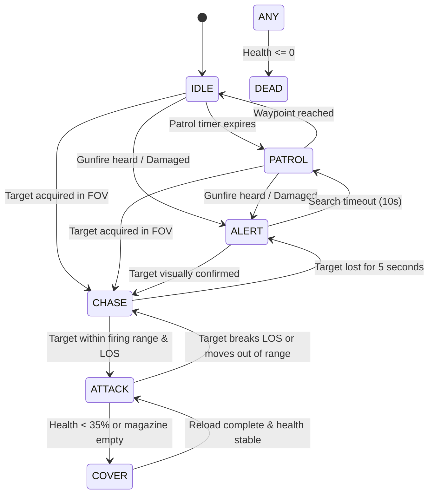

# AI Systems Specification — Yangon Frontline

## 1. Overview & Architecture
The AI subsystem controls non-player soldiers in offline single-player and acts as bot fillers in multiplayer sessions. It operates on a modular, event-driven Finite State Machine (FSM) utilizing Godot's built-in 3D navigation engine (`NavigationAgent3D`).

---

## 2. Finite State Machine (FSM)

---

## 3. Perception System
- **Visual Sight Cone:**
  - Forward Field of View (FOV): 90 degrees total (±45° from facing vector).
  - Maximum Detection Range: 35 meters in broad daylight; reduced to 18 meters around smoke/cover.
  - Raycast LOS Check: Casts from AI eye height (`y = 1.6m`) to target's head and center of mass. Intersecting with World Geometry blocks detection.
- **Hearing / Acoustic Detection:**
  - Unsuppressed gunshots within 40m radius immediately transition the AI into `ALERT` and sets the noise source as the investigation point.
- **Team Identification:**
  - AI reads `team_id` on discovered `HitboxComponent`. Allies (`same team`) are ignored; opponents trigger combat protocols.

---

## 4. Combat & Attack Mechanics
- **Weapon Handling:**
  - AI operates an `MA-1 Vanguard` rifle with simulated burst fire: 3–5 round bursts followed by a 0.6s pause.
  - Accuracy spread: 1.5° base angular deviation, increasing during rapid bursts.
- **Damage Reaction:**
  - Taking damage from an unseen angle rotates the AI 180° towards the damage origin vector and triggers aggressive cover seeking.

---

## 5. Performance Budget
- Maximum active ticking AI agents: 16 simultaneous units.
- Perception checks run at staggered 5Hz intervals (every 0.2s) per agent rather than every physics tick (`_physics_process`).
- AI agents beyond 60m from active action enter a low-frequency tick state (1Hz).
