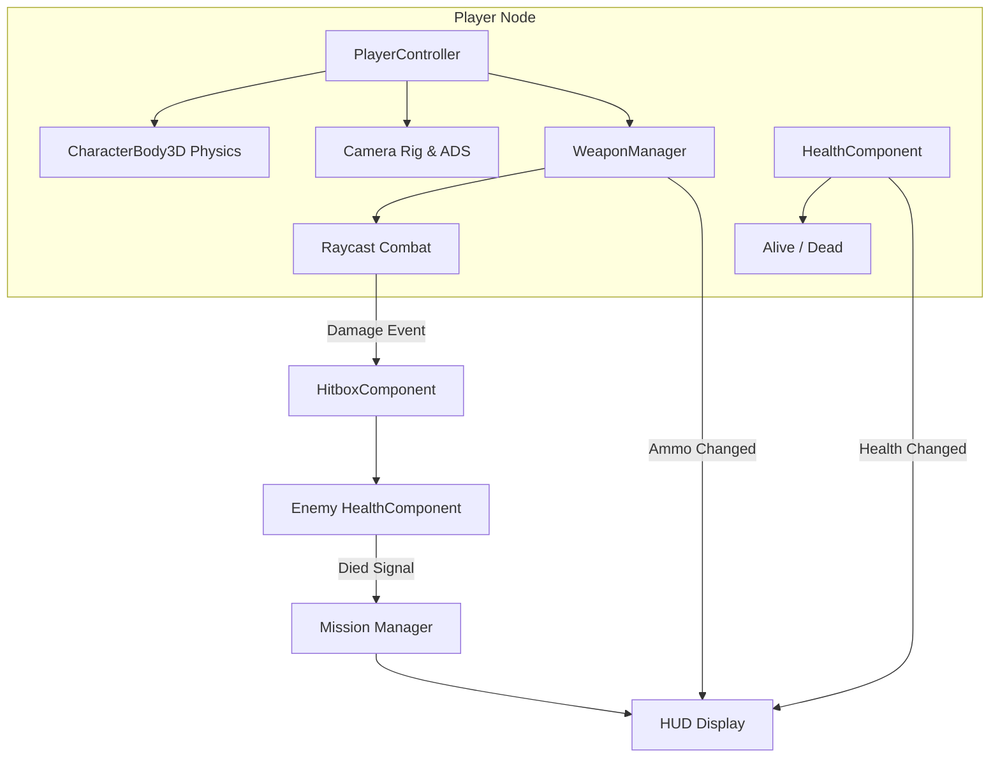

# System Architecture — Yangon Frontline

## 1. System Overview & Technology Stack
- **Engine:** Godot Engine 4.7.2 (Self-contained, Drive D:)
- **Language:** GDScript 2.0 with static typing
- **Renderer:** `gl_compatibility` (WebGL2 / OpenGL ES 3.0)
- **Target Platforms:** Windows Desktop, Modern Web Browsers (Chrome/Edge/Firefox)
- **Networking Model:** Authoritative Server with WebSocket transport layer

---

## 2. Architectural Principles
1. **Simulation vs. Transport Decoupling:**
   - The local gameplay simulation (controller, raycasts, health, AI states) must run identically without network hooks.
   - Multiplayer networking acts as a synchronization layer on top of the simulation.
2. **Component Separation:**
   - Characters (`CharacterBody3D`) do not contain weapon logic or inventory state directly.
   - Dedicated components handle isolated concerns: `PlayerController`, `HealthComponent`, `WeaponManager`, `HitboxComponent`.
3. **Data-Driven Definitions:**
   - Weapons, AI profiles, and team data are specified via clean data dictionaries or Godot `Resource` scripts.

---

## 3. Scene Structure Hierarchy
```
scenes/
├── main/
│   ├── main_game.tscn           # Top-level coordinator scene
│   └── game_world.tscn          # Complete urban Yangon battlefield
├── player/
│   ├── player.tscn              # First-person player rig & controller
│   └── remote_player.tscn       # Multiplayer replicated puppet player
├── weapons/
│   ├── rifle_m1.tscn            # Low-poly MA-1 Vanguard model & flash
│   └── bullet_tracer.tscn       # High-speed visual tracer effect
├── characters/
│   ├── ai_soldier.tscn          # Base AI agent with navigation & weapon
│   └── ragdoll.tscn             # Death state visual proxy
├── environment/
│   ├── building_colonial_01.tscn
│   ├── building_shophouse_01.tscn
│   ├── street_props.tscn        # Barricades, power lines, bus, debris
│   └── lighting_setup.tscn      # Directional sun, environment sky, ambient light
├── missions/
│   └── mission_clear_sector.tscn
└── ui/
    ├── hud.tscn                 # Reticle, health bar, ammo count, objective
    ├── pause_menu.tscn          # In-game pause & sensitivity settings
    └── game_over_screen.tscn    # Victory/Defeat display & restart prompt
```

---

## 4. Component Interaction Diagram


---

## 5. Combat & Damage Pipeline
1. **Trigger Pull:** Player or AI activates `WeaponManager.fire()`.
2. **Raycast Query:** A direct physics raycast query is cast from the camera viewport center forward along weapon range.
3. **Collision Filter:** Raycast tests against Layer 1 (World Geometry) and Layer 2 (Characters).
4. **Hit Resolution:**
   - If collision is with an entity containing `HitboxComponent`, `HitboxComponent.receive_damage(amount, source_team, hit_position)` is called.
   - Friendly fire is filtered by checking `source_team != target_team`.
5. **Visual Feedback:** Impact sparks on concrete/metal, blood puffs on character hits, and dynamic muzzle flash.

---

## 6. AI Architecture
- **State Machine:** Deterministic finite state machine: `IDLE`, `PATROL`, `CHASE`, `ATTACK`, `DEAD`.
- **Navigation:** Godot `NavigationAgent3D` utilizing a baked `NavigationMesh` on the urban streets and sidewalks.
- **Perception:** Periodic line-of-sight raycasts to detect targets within a 90-degree forward arc and 30-meter radius.

---

## 7. Web & Browser Specifics
- **Mouse Capture:** On browser, pointer capture requires user interaction (`Input.set_mouse_mode(Input.MOUSE_MODE_CAPTURED)`). An overlay start screen captures mouse on first click.
- **Audio Context:** Web browsers block audio playback until user click. Handled via interactive start overlay.
- **Rendering Backend:** Godot Compatibility backend (`gl_compatibility`) produces WebGL2 shaders compatible with Chromium and Gecko.

---

## 8. Multiplayer Protocol & Authority Boundaries
- **Transport:** WebSocket Multi-Platform Peer (`WebSocketMultiplayerPeer`).
- **Authority:** Dedicated or Host Server validates:
  - Bullet hit validation (raycast server verification).
  - Player health, deaths, and respawn positions.
  - Team scores and match timer.
- **Client Prediction:** Client immediately performs local movement and visual recoil, reconciling positions against server snapshots at 20Hz.
