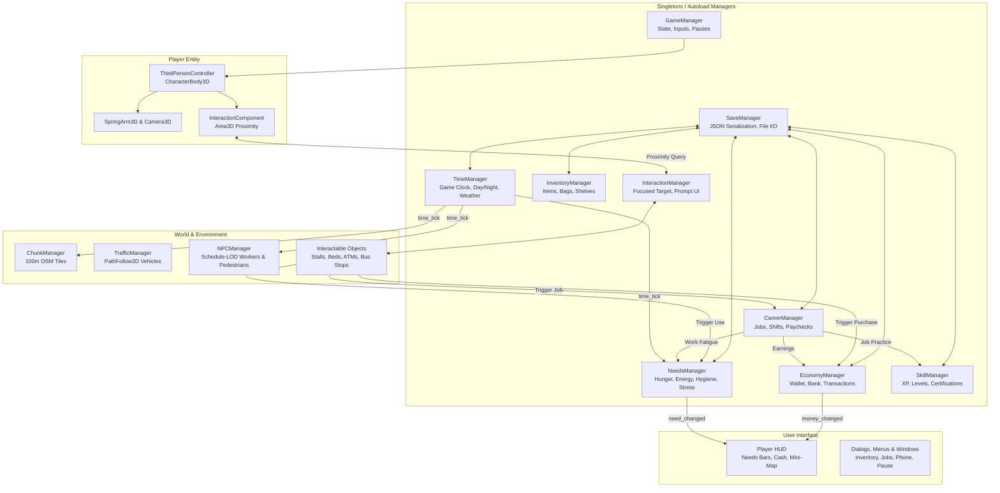
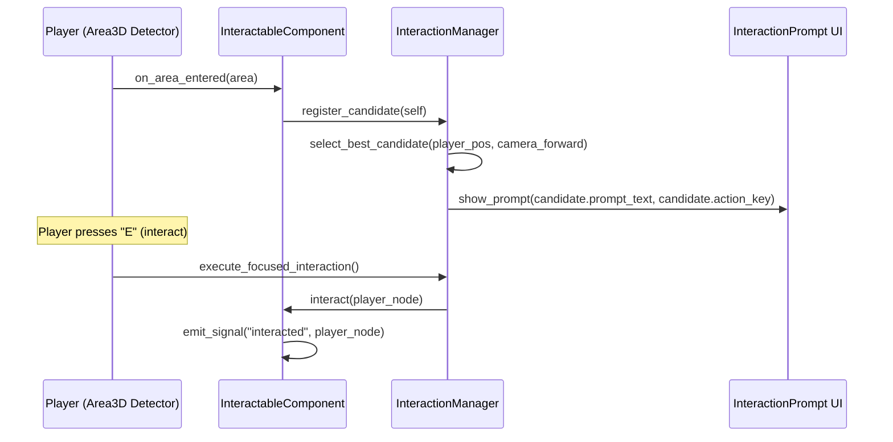

# System Architecture — Yangon Life (ရန်ကုန် ဘဝ)

---

## 1. Architectural Overview & Technology Stack
- **Game Engine:** Godot Engine 4.7.2 (Self-contained at `D:\Tools\Godot\`)
- **Primary Language:** GDScript 2.0 with static typing enabled
- **Rendering Backend:** `gl_compatibility` (OpenGL ES 3.0 / WebGL2 compliant)
- **Target Platforms:** Windows 10/11 Desktop, Modern Web Browsers (Chrome, Firefox, Edge)
- **Architectural Paradigms:** Component-based entity design, data-driven resources, simulation-transport decoupling, reactive event signals.

---

## 2. Component Interaction & Data Flow
The core simulation runs decoupled from rendering and networking. Autoload singletons maintain persistent state and emit signals to UI and world representations.



---

## 3. Scene Structure Hierarchy
The project structure is organized by functional domain to prevent monolithic coupling:

```
scenes/
├── main/
│   ├── main_game.tscn              # Root scene loading world, player, and HUD
│   ├── session_manager.tscn        # Manages offline vs. multiplayer session start
│   └── start_screen.tscn           # Web browser click-to-start / audio unlock overlay
├── player/
│   ├── player_character.tscn       # CharacterBody3D, mesh, animations, collision
│   ├── camera_rig.tscn             # SpringArm3D + Camera3D with collision margins
│   ├── interaction_detector.tscn   # Area3D detecting nearby InteractableComponent nodes
│   └── remote_player.tscn          # Interpolated puppet rig for online multiplayer
├── world/
│   ├── downtown_map.tscn           # Top-level world scene containing chunk root
│   ├── chunk_tile_base.tscn        # Base node for 100m x 100m procedural OSM chunks
│   ├── day_night_cycle.tscn        # DirectionalLight3D, WorldEnvironment, Sun/Moon
│   └── weather_controller.tscn     # Rain particle system, cloud densities, puddle shader
├── ui/
│   ├── hud.tscn                    # Needs bars, MMK cash display, clock, quick slot
│   ├── interaction_prompt.tscn     # Contextual floating 3D/2D prompt ("[E] Buy Mohinga")
│   ├── inventory_menu.tscn         # Grid-based item bag and storage containers
│   ├── phone_interface.tscn        # Smartphone OS: banking app, job board, map app
│   ├── dialogue_box.tscn           # NPC dialogue choices, portraits, relationship bar
│   ├── shop_interface.tscn         # Buy/Sell retail interface with item prices
│   ├── career_window.tscn          # Shift progress, task checklist, rating meter
│   └── pause_menu.tscn             # Settings, save slot management, return to menu
├── vehicles/
│   ├── vehicle_base.tscn           # Base kinematic/physics vehicle container
│   ├── taxi_sedan.tscn             # Driveable / passenger yellow-top taxi
│   ├── delivery_bicycle.tscn       # Pedal bicycle with basket cargo
│   ├── delivery_motorbike.tscn     # 125cc urban scooter
│   └── ybs_bus.tscn                # Yangon Bus Service municipal transit vehicle
├── npcs/
│   ├── npc_pedestrian.tscn         # Schedule-driven walking pedestrian
│   ├── npc_shopkeeper.tscn         # Stationary vendor at kiosk or retail counter
│   ├── npc_customer.tscn           # Dynamic retail shopper wandering shop aisles
│   └── npc_monk.tscn               # Morning alms-seeking monk archetype
└── interactables/
    ├── stall_mohinga.tscn          # Food stall restoring Hunger and Energy
    ├── shop_counter.tscn           # Retail cashier station for store operations
    ├── residential_bed.tscn        # Bed restoring Energy, advancing time, saving game
    ├── atm_machine.tscn            # KBZ/CB/AYA style ATM for deposits & withdrawals
    ├── bus_stop_shelter.tscn       # Transit stop for waiting on YBS bus lines
    └── pagoda_shrine.tscn          # Spiritual reflection post reducing Stress
```

---

## 4. Player Controller (`ThirdPersonController`)
The player character is a third-person entity built on `CharacterBody3D`:

- **Node Composition:**
  - `CharacterBody3D` (Collision layer 2: Characters; mask: 1 World, 3 Vehicles)
  - `CollisionShape3D` (Capsule shape: radius 0.35m, height 1.8m)
  - `MeshInstance3D` / AnimatedModel (Low-poly humanoid rig)
  - `SpringArm3D` (Spring length 3.5m, margin 0.2m, collision mask: 1 World)
    - `Camera3D` (FOV 70°, near 0.1m, far 300m)
  - `InteractionDetector` (`Area3D`, sphere radius 2.0m, collision mask: 4 Interactables)

### Locomotion Logic
- **Camera-Relative Movement:** Direction vectors are projected relative to the camera's horizontal yaw:
  ```gdscript
  var cam_forward: Vector3 = -camera.global_transform.basis.z
  cam_forward.y = 0.0
  cam_forward = cam_forward.normalized()
  var cam_right: Vector3 = camera.global_transform.basis.x
  cam_right.y = 0.0
  cam_right = cam_right.normalized()
  var move_dir: Vector3 = (cam_forward * input_vector.y + cam_right * input_vector.x).normalized()
  ```
- **Orientation & Smoothing:** Character model smoothly rotates toward `move_dir` using `transform.basis.slerp()`.
- **Sprint & Stamina Connection:** Sprinting doubles velocity from 3.2 m/s to 6.5 m/s. Sprinting is permitted only when `NeedsManager.can_sprint()` returns true (`energy > 15.0`) and drains energy slightly while active.
- **Physics Tuning:** Accelerated ground velocity (12.0 m/s²), snappy ground friction (10.0 m/s²), realistic gravity (19.6 m/s²), jump impulse (5.5 m/s).

---

## 5. Interaction System
The interaction system connects the player to interactive world objects through modular proximity queries:



- **`InteractableComponent` (`Node3D`):** Reusable component added as a child of any interactive object. Exports:
  - `prompt_text: String` (e.g., "Eat Mohinga (2,500 MMK)", "Rest in Bed", "Open Kiosk")
  - `action_code: StringName = &"interact"`
  - `interaction_range: float = 2.0`
  - `requires_line_of_sight: bool = true`
- **Priority Resolution:** When multiple interactables are in range, `InteractionManager` selects the one with the smallest angle relative to the player's camera forward vector.

---

## 6. Economy System (`EconomyManager`)
- **Autoload File:** `res://scripts/economy/economy_manager.gd`
- **Responsibilities:**
  - Manages player's liquid cash wallet (`balance: int`) and bank account balance (`bank_balance: int`).
  - Starting baseline: 50,000 MMK cash in wallet.
  - Transaction safety: Validates that expenses cannot execute if funds are insufficient (`can_afford(amount)`).
  - Emits `money_changed(new_balance: int)` and `transaction_completed(amount: int, reason: String)`.
  - Maintains a circular audit log of the last 50 transactions for display on the smartphone bank app.
  - Serialization hook: `get_save_data()` and `load_save_data()`.

---

## 7. Needs System (`NeedsManager`)
- **Autoload File:** `res://scripts/simulation/needs_manager.gd`
- **Tracked Attributes:** `hunger: float`, `energy: float`, `hygiene: float`, `stress: float` (0.0 to 100.0).
- **Update Frequency:** Process tick every 1.0 real-world second, representing 1 game minute.
- **Decay Tuning:**
  - Hunger: -6.0 per game-hour (requires 2–3 meals per game-day)
  - Energy: -4.0 per game-hour (requires 6–8 hours of sleep per game-day)
  - Hygiene: -2.5 per game-hour (requires daily bathing)
  - Stress: +1.5 per game-hour (mitigated by leisure and tea shop relaxation)
- **Work Efficiency Scaling:** Returns a scalar (0.2 to 1.0) based on need penalties, directly reducing job output and tips when needs are neglected.
- **Signals:** `need_changed(need_name: String, value: float)`, `need_critical(need_name: String)`.

---

## 8. Career System (`CareerManager`)
- **Autoload File:** `res://scripts/careers/career_manager.gd`
- **Data Resource (`JobDefinition` extends `Resource`):**
  - `job_id: String` (e.g., `"taxi_driver"`, `"shopkeeper"`, `"delivery_worker"`)
  - `job_title_en: String`, `job_title_my: String`
  - `base_hourly_wage: int`
  - `required_skill: StringName`, `required_skill_level: int`
  - `shift_start_hour: int`, `shift_duration_hours: int`
- **Work Session Lifecycle:**
  1. `start_shift(job_id)` initializes shift timer, registers shift tasks.
  2. During shift, player completes job objectives (delivering meals, ringing up purchases, transporting fares).
  3. `end_shift()` calculates gross wages, performance bonuses (scaled by Customer Service skill and Needs efficiency), deposits payout via `EconomyManager.add_money()`, and records XP via `SkillManager`.

---

## 9. Skill System (`SkillManager`)
- **Autoload File:** `res://scripts/careers/skill_manager.gd`
- **Tracked Skills:** `driving`, `customer_service`, `business_mgmt`, `cooking`, `repair`, `tech`, `fitness`, `charisma`.
- **Progression Math:**
  $$\text{XP Required for Level } L = 100 \times L^{1.5}$$
- **Milestone Rewards:** Reaching Level 3, 5, and 10 unlocks career certifications (e.g., Commercial Driver License, Food Safety Permit) and permanent passive bonuses.

---

## 10. Inventory System (`InventoryManager`)
- **Data Resource (`ItemResource` extends `Resource`):**
  - `item_id: String`
  - `display_name: String`
  - `category: String` (`"food"`, `"beverage"`, `"merchandise"`, `"tool"`, `"key"`)
  - `unit_cost: int`, `unit_value: int`
  - `max_stack: int` (default 20, tools 1)
  - `need_effects: Dictionary` (e.g., `{"hunger": +35.0, "stress": -10.0}`)
- **Container Architecture:** Player backpack (16 slots), vehicle trunk (20–40 slots), shop display shelves (30 slots), home wardrobe (50 slots). Standard drag-and-drop / click-to-transfer item protocol.

---

## 11. Save & Load System (`SaveManager`)
- **Format:** Human-readable, versioned JSON stored in Godot's safe user data path: `user://savegame_slot_{0,1,2}.json`.
- **Version Migration:** Each save file contains an integer `"version": 1`. When future versions alter schemas, `SaveManager` executes sequential migration routines.
- **Serialization Contract:**
  ```json
  {
    "version": 1,
    "timestamp": 1776582400,
    "playtime_seconds": 3420,
    "player": {
      "transform": [1.0, 0.0, 0.0, 0.0, 1.0, 0.0, 0.0, 0.0, 1.0, 12.4, 0.1, -45.2],
      "active_housing_id": "hostel_pansodan_bunk_3"
    },
    "economy": {
      "balance": 54200,
      "bank_balance": 120000
    },
    "needs": {
      "hunger": 76.5,
      "energy": 88.0,
      "hygiene": 92.0,
      "stress": 14.2
    },
    "skills": {
      "driving": {"level": 2, "xp": 140},
      "customer_service": {"level": 1, "xp": 45}
    },
    "careers": {
      "active_job": "delivery_worker",
      "shift_in_progress": false
    },
    "time": {
      "day_count": 3,
      "time_seconds": 28800
    }
  }
  ```

---

## 12. NPC Simulation Architecture
- **Data Resource (`NPCSchedule` extends `Resource`):** Array of schedule waypoints `[{ "time_hour": 7.5, "location_id": "tea_stall_sule", "posture": "sitting", "dialogue_pool": "morning" }]`.
- **Three-Tier Distance LOD:**
  - **LOD 0 (< 50m):** `CharacterBody3D` active. Full 3D low-poly model rendered, collision enabled, IK head tracking looks toward player.
  - **LOD 1 (50m–150m):** Stripped `Node3D`. Model rendered as non-skinned low-poly proxy; moves along predefined street path waypoints with linear interpolation; physics collision disabled.
  - **LOD 2 (> 150m):** Entity culled from scene tree. Represented purely as a lightweight memory record in `NPCManager`. Evaluates schedule milestones based on game clock.

---

## 13. Traffic Simulation
- **Path-Following Topology:** Roads have baked 3D curves (`Path3D`) defining standard vehicle lanes (left/right traffic matching Myanmar urban convention).
- **Traffic Agents:** Low-poly sedans, pickup trucks, and buses attach to `PathFollow3D` nodes.
- **Raycast Obstacle Detection:** A forward `RayCast3D` (length 8.0m) detects vehicles or pedestrians ahead. If hit, the vehicle decelerates to zero; when clear, it accelerates back to lane cruising speed (30–45 km/h).
- **Spawn/Despawn Bubble:** Vehicles spawn at chunk perimeter gates 200m away from the player and despawn when exiting the active perimeter ring.

---

## 14. Map & Coordinate System
- **Real-World Mapping:** Derived from OpenStreetMap vector footprints.
- **Projection Reference Point:** Sule Pagoda center `(16.7735° N, 96.1581° E)` maps to Godot `Vector3(0, 0, 0)`.
- **Axes Convention:**
  - `+X`: East (meters)
  - `-X`: West (meters)
  - `+Y`: Elevation Up (meters)
  - `-Y`: Elevation Down (meters)
  - `-Z`: North (meters)
  - `+Z`: South (meters)
- **World Chunking:** The city is split into uniform 100m x 100m grid tiles. `ChunkManager` loads chunks within an active radius (200m) and unloads distant tiles, preventing memory strain on WebGL2.

---

## 15. Multiplayer Architecture (WebSocket Model)
- **Transport Peer:** `WebSocketMultiplayerPeer` (runs identically on native desktop and inside browser WASM).
- **Authority Model:** Dedicated / Host Server Authoritative.
  - Server maintains the single source of truth for:
    - Player MMK balances and market inventory.
    - Day/Night clock and city weather.
    - Global business ownership and leased property registry.
  - Clients simulate local character movement and predict interaction responsiveness, sending RPC requests (`rpc_request_purchase`, `rpc_request_work_task`) to the server for authoritative validation.

---

## 16. Web & Browser Specifics
- **Mouse Pointer Lock:** Web security requires user gesture before capturing pointer:
  - Game boots with a GUI splash overlay ("Click to Begin Life in Yangon").
  - On the first `_gui_input` mouse click, the overlay hides, `Input.set_mouse_mode(Input.MOUSE_MODE_CAPTURED)` is called, and the audio engine is unmuted.
- **Audio Context Unlock:** WebAudio context remains suspended until user interaction; initialization logic is hooked into the initial click event.
- **Memory Budgeting:** WebGL2 browser limits dictate total memory footprint under 250MB. All textures use compressed VRAM formats, and unused chunks are freed from memory (`queue_free()`).
