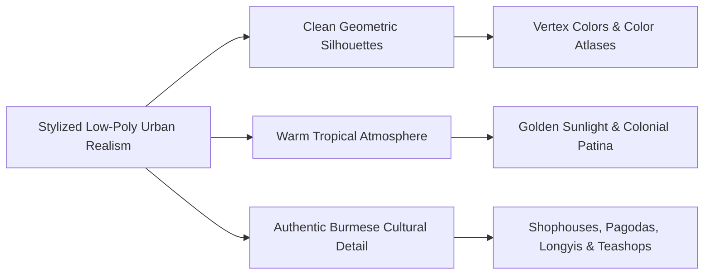
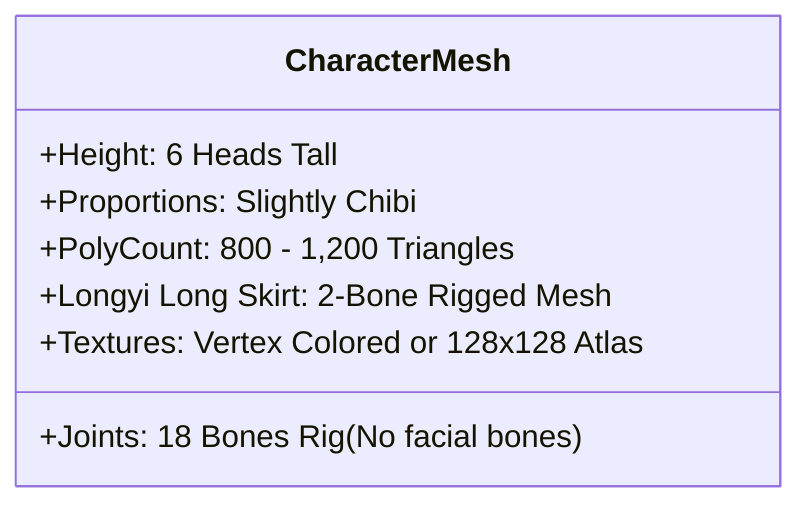
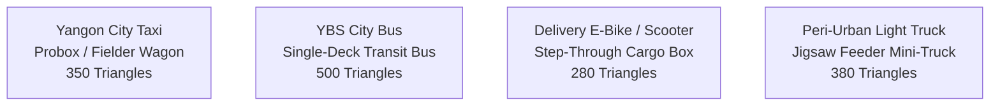
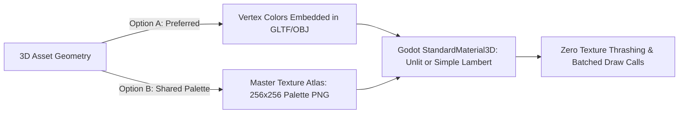

# Art Bible & Visual Style Guide — Yangon Life

## 1. Visual Direction & Style Identity

**Yangon Life** is visually defined by **Stylized Low-Poly Urban Realism**—a synthesis reminiscent of *The Sims* meets a clean, miniature *Cities: Skylines*, rendered with the warmth, character, and distinctive architecture of Yangon, Myanmar.



### Core Visual Pillars
1. **Readable Geometry:** Crisp, un-subdivided low-poly planar surfaces. Silhouettes must read instantly from street-level third-person cameras and top-down minimaps.
2. **Warm Tropical Tone:** Bright tropical sunlight, golden hour highlights, sun-faded colonial plaster, and saturated street-level plastic stools and parasols.
3. **Cultural Authenticity:** Authentic representation of Myanmar urban elements—traditional Longyi garments, Thanaka facial paste, colonial teak louvers, iron folding gates, gilded stupas, and street vendors.
4. **Extreme Performance Budget:** Strict triangle, draw-call, and texture budgets ensuring 60 FPS in browser WebGL2 exports (`gl_compatibility`) and low-spec mobile/desktop devices.

---

## 2. Color Palette & Lighting Model

The color palette reflects Yangon's historic architecture, tropical flora, and religious landmarks:

```
+-----------------------------------------------------------------------------------------+
|                                    PALETTE SWATCHES                                     |
| Swatch Name        Hex Code   Godot Color(r,g,b)          Usage Context                 |
| --------------------------------------------------------------------------------------- |
| Colonial Cream     #D5CFBE    Color(0.835, 0.812, 0.745)  Heritage facades, plaster     |
| Pagoda Gold        #DAA520    Color(0.855, 0.647, 0.125)  Stupas, spires, religious hti |
| Monsoon Green      #4B5320    Color(0.294, 0.325, 0.125)  Tropical palms, mossy patina  |
| Road Asphalt       #3D3D3D    Color(0.239, 0.239, 0.239)  Street roadways, curbstones   |
| Tropical Sky Blue  #87CEEB    Color(0.529, 0.808, 0.922)  Midday skybox, canal waters   |
| Teashop Red        #D9381E    Color(0.851, 0.220, 0.118)  Plastic stools, awnings       |
| Plastic Chai Blue  #2B74B8    Color(0.169, 0.455, 0.722)  Water drums, delivery crates  |
| Teakwood Brown     #5C4033    Color(0.361, 0.251, 0.200)  Balconies, temple doors       |
+-----------------------------------------------------------------------------------------+
```

### 2.1. Lighting Setup
- **Renderer:** Godot 4.7.2 `gl_compatibility` (OpenGL ES 3.0 / WebGL2).
- **Primary Light Source:** Single `DirectionalLight3D` acting as the Sun / Moon.
  - *Sun Color:* Warm daylight `Color(1.0, 0.96, 0.88)` at noon; transitioning to rich amber `Color(1.0, 0.68, 0.38)` during golden hour (06:00 - 07:30 and 17:00 - 18:30).
  - *Shadow Quality:* Directional shadow mode `Orthogonal` or `PSSM 2 Splits`, 1024x1024 map size, simple shadow filtering (PCF13 or PCF5).
- **Ambient Light:** Warm sky tint via `WorldEnvironment` background color or gradient procedural sky.
- **Night Illumination:** Limited to 3–4 dynamic omni/spotlights for key neon signs; most night lights are rendered using self-illuminated emissive unlit materials or vertex color glow.

---

## 3. Character Proportions & Modeling Guidelines

Characters are stylized, friendly, and expressive, striking a balance between readable humanoid anatomy and lightweight geometry.



```
Character Proportion Guide (6 Heads):
   [   O   ]  Head 1: Head / Face (Slightly enlarged, expressive eyes, hair/cap)
   [---|---]  Head 2: Neck & Upper Torso (Chest, collared shirt or casual tee)
   [ |===| ]  Head 3: Abdomen & Waist (Longyi knot / belt line)
   [ |   | ]  Head 4: Upper Thighs / Longyi drape
   [ |   | ]  Head 5: Lower Calves / Longyi hem
   [  _|_  ]  Head 6: Feet & Sandals (Burmese velvet/rubber Hnyat-phanat)
```

### Character Design Rules
- **Height & Head Ratio:** Exactly **6 heads tall** (moderately chibi proportions; avoids hyper-realistic uncanny valley while fitting low-poly vehicles).
- **Limb Geometry:** Simple cylindrical or tapered box limbs with bevels at knees and elbows. Hands are stylized mittens or 3-finger forms.
- **Cultural Garments:**
  - *Male Characters:* Collared shirt / eingyi, traditional pleated Longyi (cylinder mesh extending to ankles), velvet flip-flops.
  - *Female Characters:* Burmese blouse (yinzi/yinbon), patterned htamain (female Longyi), traditional Thanaka circular powder patches on cheeks.
  - *Uniforms:* Delivery vests with logos, taxi driver caps, business trousers, shop aprons.
- **Poly Budget:** 800 to 1,400 triangles per character model.

---

## 4. Vehicle Proportions & Modeling Guidelines

Vehicles represent Yangon's authentic street fleets, simplified into clean, recognizable low-poly silhouettes.



### Vehicle Geometry Rules
- **Triangle Budget:** Strictly **200 to 500 triangles per vehicle**.
- **Wheels:** Octagonal (8-sided) or decagonal (10-sided) cylinders with dark rubber vertex colors.
- **Windows:** Stylized opaque tinted glass (`#2C3539` with slight gloss) with white silhouette reflection stripes; no complex interior cabin geometry needed for standard traffic LODs.
- **Drivable Player Vehicles:** Feature simplified low-poly steering wheel and seat interior (adds ~150 triangles).
- **Vehicle Fleet Types:**
  - *Yangon Taxi:* White station wagon with yellow roof taxi sign and red door registration band.
  - *YBS City Bus:* Yellow/Red low-poly transit bus with route number marquee on windshield.
  - *Delivery Bicycle / E-Bike:* Lightweight frame with rear insulated thermal food delivery cube (`#D9381E`).
  - *Private Passenger Sedans:* Simplified low-poly saloons in silver, white, and bronze.

---

## 5. Building & Environment Proportions

Building models are constructed from OpenStreetMap geographic 2D footprints, extruded to accurate urban heights, and adorned with modular low-poly architectural facade elements.

```
Modular Facade System:
+-------------------------------------------------------+
| Roof Cornice / Overhang Water Tank & TV Antennas      |
+-------------------------------------------------------+
| Floor 4: Shuttered Windows, Iron Balcony Railing      |
+-------------------------------------------------------+
| Floor 3: Wooden Louvers, Air Conditioning Compressor  |
+-------------------------------------------------------+
| Floor 2: Arched Colonial Masonry Windows              |
+-------------------------------------------------------+
| Ground Floor: Steel Rollup Shutter / Teashop Awnings  |
+-------------------------------------------------------+
```

### Architectural Modeling Standards
- **Footprint Accuracy:** Matches real OSM polygon coordinates, snapped to a 0.5-meter grid.
- **Storey Heights:** Ground floor commercial = 3.5m; upper residential floors = 3.0m each.
- **Facade Details:** Louver slats, exterior concrete balconies, air conditioner compressor boxes, overhead water tanks, and television aerials are separate modular low-poly instanced sub-meshes.
- **Alley Dressing:** Wall drainage pipes, electric meters with tangled utility wire clusters (simple 3-vertex quad strips), roll-up metal doors.

---

## 6. Materials, Shaders & Texturing Rules

To maintain instantaneous WebGL2 loading and minimal GPU memory footprint, textures are minimized in favor of vertex colors and master color atlases.



### 6.1. Material Rules
- **Shading Model:** `Lambert` (simple diffuse lighting with low-cost specular highlights) or `Unlit` for distant LODs and UI elements.
- **No Complex PBR:** Normal maps, roughness maps, metallic maps, and ambient occlusion maps are strictly omitted from standard assets. Depth and shading are modeled directly into vertex geometry or baked into vertex colors.
- **Vertex Coloring:** Where possible, building walls, sidewalks, and foliage use vertex color attributes, requiring zero texture fetches.

### 6.2. Master Texture Palette Atlas
- **Texture Size:** Master color atlas of `256 x 256` pixels containing a grid of 64 solid color swatches.
- **UV Mapping:** Model faces are UV-unwrapped to a single pixel or small rectangle inside the corresponding color swatch on the atlas.
- **Max Unique Textures:** Total loaded textures across the entire project must stay **under 64 MB VRAM**.

---

## 7. Animation Standards

Character and prop animations are designed for responsiveness, lightweight bone counts, and clarity.

| Animation Clip | Target FPS Keyframes | Loop Mode | Description |
|---|---|---|---|
| `idle_stand` | 12 FPS keyframed | Loop | Relaxed posture, subtle chest breathing, occasional weight shift. |
| `walk` | 24 FPS keyframed | Loop | Confident urban stride, arms swinging rhythmically, Longyi skirt sway. |
| `run` | 24 FPS keyframed | Loop | Dynamic forward lean, higher knee lift, hurried urban transit motion. |
| `sit_chair` | Static pose | Hold | Seated on low plastic stool or office swivel chair. |
| `eat_drink` | 12 FPS keyframed | One-shot | Lifting teacup / spoon to mouth with slight head nod. |
| `interact_reach` | 12 FPS keyframed | One-shot | Reaching right arm forward to interact with ATM, door, or cash register. |
| `drive_steer` | 12 FPS keyframed | Loop / Blend | Hands on steering wheel, slight turns left/right. |

- **Rig Complexity:** Standard humanoid rig has **18 bones maximum** (Hips, Spine, Chest, Neck, Head, 3 per arm, 3 per leg, 2 for Longyi skirt drape). No individual finger bones or facial bones.

---

## 8. Asset Naming Conventions & Organization

All project assets must strictly follow hierarchical snake_case naming conventions:

### 8.1. File Naming Rules
- **3D Meshes:** `mesh_<category>_<name>_<variant>.glb`
  - *Examples:* `mesh_veh_taxi_sedan.glb`, `mesh_bld_tenement_sule_01.glb`, `mesh_prop_stool_plastic_red.glb`
- **Materials:** `mat_<category>_<name>.tres`
  - *Examples:* `mat_world_palette_atlas.tres`, `mat_glass_tinted.tres`
- **Textures:** `tex_<name>_<type>.<ext>`
  - *Examples:* `tex_master_palette_256.png`, `tex_ui_icons_sheet.png`
- **Scenes:** `scn_<name>.tscn`
  - *Examples:* `scn_player.tscn`, `scn_car_taxi.tscn`, `scn_district_sule.tscn`

### 8.2. Categories
- `char_`: Characters and NPCs
- `veh_`: Vehicles (cars, buses, bikes)
- `bld_`: Buildings and major structures
- `prop_`: Street furniture, shop wares, interactables
- `env_`: Foliage, roads, terrain, curbs

---

## 9. Performance & Budget Thresholds

To guarantee compatibility with Godot 4.7.2 on WebGL2, Chrome OS, and budget hardware, every scene must satisfy these performance metrics:

```
+-------------------------------------------------------------------------------+
|                           PERFORMANCE BUDGET CEILING                          |
| Metric                        Budget Limit          Verification Tool         |
| ----------------------------------------------------------------------------- |
| Visible Triangles (Rendered)  < 50,000 tris         Godot Monitor / Debugger  |
| Total Draw Calls              < 150 calls           Godot Monitor (Draw Calls)|
| Active Loaded Textures        < 64 MB VRAM          Engine Memory Profiler    |
| Character Skeleton Bones      <= 18 bones / rig     Blender / GLTF Exporter   |
| Target Frame Rate (Desktop)   60 FPS (V-Sync)       In-Game Debug Overlay     |
| Target Frame Rate (Browser)   60 FPS (WebGL2)       Chrome/Firefox Profiler   |
+-------------------------------------------------------------------------------+
```
