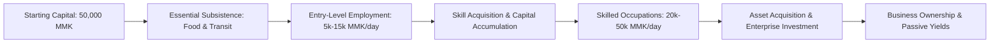
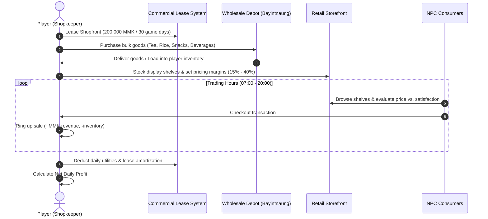
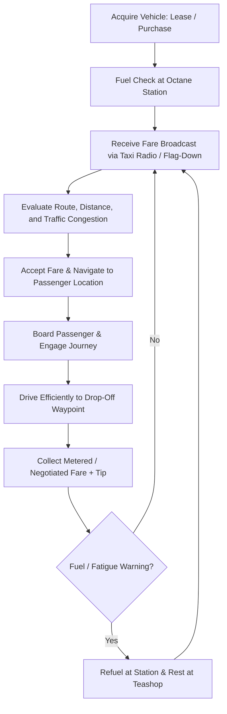
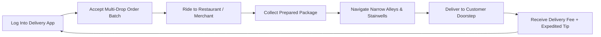
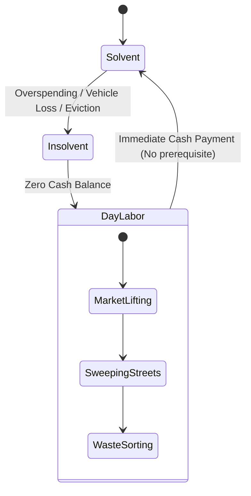

# Careers and Economy Design — Yangon Life

## 1. Executive Overview & Currency Fundamentals

**Yangon Life** simulates the socioeconomic tapestry of Yangon, Myanmar, through an authentic, grounded economic model. Players navigate the city's financial realities—from humble street-level gigs to thriving commercial enterprises—grounded in real-world Yangon dynamics.

### Currency System: Myanmar Kyat (MMK)
- **Primary Unit:** Myanmar Kyat (`MMK` / `Ks`).
- **Sub-units:** Non-fractional (no cents/pyas in modern circulation).
- **Starting Liquidity:** **50,000 MMK** (~$24 USD baseline equivalent in purchasing power).
- **Economic Baseline:** Designed to afford 3-5 days of basic sustenance and municipal transit while seeking initial employment, establishing an engaging early-game survival threshold without punishing new players.



---

## 2. Occupations Matrix

The career ecosystem spans entry-level manual tasks, skilled vocational roles, corporate positions, and entrepreneurial pursuits.

| Occupation | Core Description | Skill Requirements | Daily Income Range | Daily / Operating Expenses | Career Progression Path |
|---|---|---|---|---|---|
| **Street Vendor** | Sells street food, fresh produce, betel nut, or cold drinks from a portable cart or curbside stand. | Cooking Lv. 1, Negotiation Lv. 1 | 6,000 – 14,000 MMK | 2,000 – 5,000 MMK (Wholesale raw materials) | Wandering Vendor → Fixed Sidewalk Stall → Night Market Food Stand |
| **Restaurant Worker** | Waits tables, washes dishes, or assists the head cook in bustling teashops and downtown restaurants. | Stamina Lv. 1, Hospitality Lv. 1 | 7,000 – 15,000 MMK | 0 MMK (Shift meal provided) | Dishwasher / Server → Line Cook → Head Teashop Brewer → Floor Manager |
| **Delivery Worker** | Transports parcels, online shopping items, and hot meals across Yangon via bicycle or e-bike. | Navigation Lv. 1, Fitness Lv. 2 | 8,000 – 18,000 MMK | 1,000 – 3,000 MMK (Bicycle maintenance / battery recharge) | Foot Courier → Bicycle Courier → E-Bike Express Courier → Logistics Fleet Lead |
| **Taxi Driver** | Navigates Yangon traffic transporting passengers between transit hubs, downtown, and outer townships. | Driving Lv. 2, Navigation Lv. 2 | 18,000 – 42,000 MMK (Gross: 35k-70k) | 15,000 – 28,000 MMK (Fuel & vehicle wear) | Hired Taxi Driver → Owner-Operator Cab → Premium Airport Shuttle |
| **Jigsaw Driver** *(Pending Clarification)* | Driver of informal neighborhood passenger transit routes (Yangon peri-urban pickup trucks / Dyna / sidecar feeder lines). | Driving Lv. 1, Local Knowledge Lv. 2 | 10,000 – 22,000 MMK | 6,000 – 12,000 MMK (Fuel & route fee) | Feeder Route Driver → Line Route Captain → Route Dispatcher |
| **Mechanic** | Diagnoses, repairs, and tunes motorbikes, cars, and delivery fleets in neighborhood auto workshops. | Mechanics Lv. 2, Engineering Lv. 1 | 20,000 – 48,000 MMK | 3,000 – 8,000 MMK (Tool consumables & parts) | Apprentice Greaser → Certified Mechanic → Master Tuner → Garage Partner |
| **Office Worker** | Executes data entry, clerical paperwork, bookkeeping, or administrative tasks in corporate towers. | Computing Lv. 2, Diligence Lv. 2 | 22,000 – 52,000 MMK | 4,000 – 8,000 MMK (Formal attire upkeep, commute lunch) | Junior Clerk → Executive Assistant → Department Supervisor → Branch Manager |
| **Shopkeeper** | Manages a brick-and-mortar retail storefront, sourcing wholesale stock, setting margins, and servicing patrons. | Commerce Lv. 2, Negotiation Lv. 2 | 25,000 – 90,000+ MMK (Net profit) | 10,000 – 40,000 MMK (Rent amortization, spoilage, restock) | Rented Kiosk → Corner Grocery (Kone-Sone-Sai) → Multi-Category Mini-Mart |

> [!NOTE]
> **Jigsaw Driver Context Note:** In Burmese urban vernacular, "Jigsaw" / informal transport colloquially references shared feeder vehicles (such as modified mini-trucks, tuk-tuks, or fixed-route passenger light trucks operating in townships like Hlaingtharya, Insein, or South Dagon where municipal bus transit is sparse). Final design will finalize whether this models fixed-fare group passenger loops or suburban cargo-hopper loops.

---

## 3. Core Career Loops

### 3.1. Shopkeeper Gameplay Loop
The shopkeeper role challenges players to balance working capital, wholesale supply chains, inventory management, and pricing elasticity.



1. **Lease Space:** Secure a downtown or suburban shophouse stall (200,000 MMK/month).
2. **Procure Stock:** Travel to wholesale distribution hubs (e.g., Bayintnaung Market or downtown wholesale alleys) to purchase consumer commodities at volume discounts.
3. **Merchandising & Pricing:** Stock store shelves, managing shelf space between high-margin specialty goods and high-velocity staples. Set retail markups (overpriced items scare customers away; underpriced items sell out quickly with thin margins).
4. **Service & Checkout:** Ring up NPC customers, monitor store cleanliness, deter petty theft, and restock depleted shelves.
5. **Reinvestment:** Upgrade refrigeration units (unlocking perishable dairy/beverages), install CCTV, or hire NPC staff clerks to automate daily operations.

---

### 3.2. Taxi Driver Gameplay Loop
The taxi driver loop models Yangon's vibrant private cab culture. Driving efficiency, route familiarity, and fuel conservation determine the bottom line.



1. **Vehicle Sourcing:** Start by leasing a standard Yangon city cab (e.g., low-poly Probox/Fielder wagon) for a daily fee, or purchase one outright.
2. **Fare Hailing:** Cruise busy districts (Sule Pagoda, Junction City, Yangon Central Railway Station) looking for roadside NPC fare beacons, or accept ride requests via the in-game mobile phone dispatch app.
3. **Route Navigation:** Select the optimal path using the mini-map, factoring in road widths (major thoroughfares vs. congested narrow alleys) and peak traffic hours.
4. **Fare Settlement:** Receive payment upon successful passenger drop-off. Passenger satisfaction (smooth driving, avoiding collisions, AC comfort) increases tip percentage.
5. **Operational Outflows:** Monitor fuel gauge; purchase fuel (Octane 92) and perform routine oil/tire servicing to maintain acceleration and fuel economy.

---

### 3.3. Delivery Worker Gameplay Loop
The delivery courier loop emphasizes swift urban mobility, physical stamina, and spatial memory across dense alleys and tenements.



1. **Order Acceptance:** Review available deliveries on the in-game phone. Orders display pickup location, delivery destination, time limit, and base payout.
2. **Batch Routing:** Experienced delivery couriers can accept up to 3 compatible orders simultaneously, planning an optimal daisy-chain route.
3. **Pickup:** Arrive at the vendor, collect parcel/food items within temperature/fragility timers.
4. **Final Mile Delivery:** Navigate tight sidewalk alleys inaccessible to cars, dismount, and walk up colonial tenement stairwells to deliver directly to residential doors.
5. **Payout:** Receive base dispatch fee (1,500 – 3,500 MMK per drop) plus punctuality bonuses and weather hazard pay during monsoon rainfall.

---

## 4. Business Ownership & Capital Scalability

Players who amass significant capital can transition from solo labor to enterprise ownership:

```mermaid
graph TD
    subgraph Small Scale [Sole Proprietorship]
        A1[Street Food Cart] --> A2[Single Kiosk]
    end
    subgraph Medium Scale [Commercial Enterprise]
        B1[Neighborhood Teashop] --> B2[Grocery Mini-Mart]
        B3[Auto Repair Garage]
    end
    subgraph Large Scale [Corporate Assets]
        C1[Multi-Location Franchise] --> C2[Logistics Vehicle Fleet]
        C3[Commercial Real Estate]
    end
    Small Scale --> Medium Scale --> Large Scale
```

### Business Mechanics
- **Initial Capital Expenditure (CapEx):** Ranging from 1,000,000 MMK (small street stall outfit) to 15,000,000+ MMK (commercial downtown building lease and multi-vehicle garage).
- **Staffing & Delegation:** Hire NPC staff (cooks, drivers, cashiers, supervisors) with varying salary levels and reliability ratings.
- **Managerial Skills:** Business success scales with the player's `Management` and `Commerce` skills, reducing employee turnover, improving stock wastage rates, and unlocking institutional business loans.
- **Passive Profit & P&L Statements:** Businesses generate daily income reports delivered to the player's smartphone dashboard, detailing gross sales, wages, rent, supply costs, and net EBITDA.

---

## 5. Living Expense Categories

To create meaningful gameplay stakes without punishing players into soft-locks, expenses simulate the realistic cost of living in Yangon:

### 5.1. Food & Sustenance
- **Street Snacks / Betel / Tea:** 500 – 1,500 MMK (Minor energy and stress relief).
- **Basic Teashop Meal (Mohinga, Fried Rice, Shan Noodles):** 2,000 – 3,500 MMK (Restores 40-60 Hunger).
- **Standard Restaurant Dine-In (Curry set with soup and sides):** 4,000 – 7,500 MMK (Full hunger recovery, stress reduction buff).
- **High-End Dining / Mall Cafe:** 10,000 – 25,000 MMK (Luxury buffs, social prestige).

### 5.2. Housing & Accommodation Rent
- **Dormitory Bedspace (Shared room, suburban township):** 80,000 – 120,000 MMK / month (~2,700 – 4,000 MMK/day).
- **Colonial Tenement Apartment (Upper floor, Downtown walk-up):** 200,000 – 350,000 MMK / month (~6,700 – 11,700 MMK/day).
- **Modern Condo / Serviced Flat (Dagon / Golden Valley outskirts):** 600,000 – 1,500,000+ MMK / month (~20,000 – 50,000 MMK/day).

### 5.3. Transportation & Fuel
- **Public Bus Fare (YBS):** 200 – 400 MMK per ride (Affordable, fixed routes, slower transit time).
- **Vehicle Fuel (Octane 92 / 95):** Dynamic market pricing, approx. 2,800 – 3,500 MMK per liter. Average car tank fills for 35,000 – 55,000 MMK, lasting multiple days of regular driving.
- **Vehicle Maintenance & Repairs:** 10,000 – 50,000 MMK per servicing cycle depending on vehicle wear and tear.

### 5.4. Vocational Training & Education
- **Driving Certification (Light Vehicle):** 60,000 MMK one-time exam/permit fee.
- **Short Vocational Courses (Mechanics, Cooking, Barista):** 50,000 – 120,000 MMK per course module (increases corresponding skill level).
- **Advanced Business & Computing Diplomas:** 200,000 – 500,000 MMK (unlocks management tiers and high-paying office jobs).

---

## 6. Financial Recovery & Zero Permanent Failure State

A core pillar of **Yangon Life** is accessibility and grounded optimism: **the player can never enter an unrecoverable bankruptcy soft-lock**.



### Safety Nets & Financial Recovery Mechanics
1. **Always-Available Odd Jobs (Day Labor):**
   - Even with 0 MMK in hand and no vehicle or tools, players can visit city markets (Theingyizay, Botahtaung jetty, municipal yards) to take un-gated odd jobs:
     - **Market Porter / Crate Carrier:** Physical minigame paying 1,500 MMK per haul.
     - **Dishwashing / Floor Sweeping:** Quick time-based activity paying 2,000 – 3,000 MMK per shift.
     - **Recyclable Bottle / Carton Collecting:** Gathering items around the city for instant redemption at junk shops.
2. **No Eviction to Black Screen:**
   - If rent defaults, the player is not killed or sent to a game over screen. They are relocated to a public bench or temporary dormitory, retaining their skills and inventory items.
3. **Emergency Micro-Loans (Friendly Teashop Uncle):**
   - An NPC neighborhood elder offers a one-time emergency stipend of 10,000 MMK to buy food and bus fare if balance hits 0 MMK, repayable with zero predatory interest.

---

## 7. Anti-Exploit & Multiplayer Balance Rules

In both offline single-player and online multiplayer sessions, the economy is safeguarded against exploits and inflation:

### 7.1. Temporal Cooldowns & Shift Fatigue
- Continuous rapid job cycling is prevented by realistic work shift cooldowns (e.g., maximum 8-12 hours of delivery or taxi shifts before physical fatigue imposes severe speed/handling debuffs).
- Odd jobs feature dynamic supply caps per city district per day.

### 7.2. Diminishing Returns on Single-Loop Farming
- Repeating the exact same courier route or spamming sales of a single item floods the local hyper-local market, temporarily softening market sale prices by up to 35% until consumer demand refreshes next game day.

### 7.3. Server-Authoritative Multi-Player Economy
- **Server State Verification:** In online multiplayer, all monetary balances, inventory counts, store transactions, and vehicle purchases are validated server-side.
- **Anti-Duplication:** Item transactions lock items in atomic transactions during trades, preventing split-second item duping via network disconnections.
- **Anti-Botting / Macro Defenses:** Interactive jobs involve variable minigame targets and positional randomized checks to prevent simple autoclicker bots.

---

## 8. Economic Balancing Principles

```
+-----------------------------------------------------------------------------------------+
|                               BALANCING RATIOS TABLE                                    |
| Level Tier       Daily Gross Range    Daily Living Cost   Net Daily Savings   Payoff Time |
| --------------------------------------------------------------------------------------- |
| Tier 1 (Entry)   8,000 - 15,000 MMK   5,000 - 8,000 MMK   3,000 - 7,000 MMK   3-5 days  |
| Tier 2 (Skilled) 25,000 - 45,000 MMK  12,000 - 20,000 MMK 13,000 - 25,000 MMK 1-2 weeks |
| Tier 3 (Business)60,000 - 180,000 MMK 30,000 - 70,000 MMK 30,000 - 110,000 MMK Month+   |
+-----------------------------------------------------------------------------------------+
```

1. **Purchasing Power Parity:** Prices reflect realistic Yangon purchasing power proportions (a hot bowl of Mohinga costs ~2,500 MMK; a new commercial motorbike costs ~3,500,000 MMK; monthly tenement rent is ~250,000 MMK).
2. **Effort-to-Reward Ratio:** Manual, active jobs (taxi navigation, delivery routing) yield instant liquidity and higher short-term earnings per minute. Passive enterprise ownership requires heavy initial capital and risk management, rewarding long-term strategy.
3. **Fluid Progression:** Progression curves are exponential in asset value but linear in basic security, ensuring the player feels tangible relief as they transition from day-to-day survival to prosperity.
