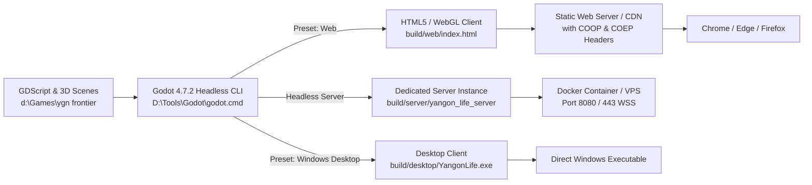

# Deployment & Export Guide — Yangon Life

**Project:** Yangon Life  
**Document Version:** 2.0.0  
**Last Updated:** 2026-10-19  
**Status:** Approved Operations Guide  

---

## 1. Overview & Drive D: Hard Isolation Policy

All tooling, Godot editor binaries, export templates, development scripts, intermediate build caches, and release packages reside exclusively on **Drive D:**. Under no circumstances should build artifacts or tools be placed on Drive C:.

### Key Path Locations
- **Godot Engine 4.7.2 (Self-Contained):** `D:\Tools\Godot\godot.cmd`
- **Self-Contained Data & Export Templates:** `D:\Tools\Godot\editor_data\export_templates\4.7.2.stable\`
- **Project Root:** `D:\Games\ygn frontier`
- **Desktop Build Output:** `D:\Games\ygn frontier\build\desktop\`
- **Web Build Output:** `D:\Games\ygn frontier\build\web\`
- **Dedicated Server Output:** `D:\Games\ygn frontier\build\server\`
- **Archive & Backup:** `D:\Games\ygn frontier\build\archive\`

---

## 2. Export Pipelines



### 2.1 Windows Desktop Export
Exports a standalone, high-performance 64-bit Windows binary with separate `.pck` resource container.

#### Command:
```powershell
& "D:\Tools\Godot\godot.cmd" --headless --path "D:\Games\ygn frontier" --export-release "Windows Desktop" "D:\Games\ygn frontier\build\desktop\YangonLife.exe"
```

#### Output Artifacts:
- `build/desktop/YangonLife.exe` (Windows executable binary)
- `build/desktop/YangonLife.pck` (Packed scene resources, models, scripts, textures)

#### Verification:
```powershell
Test-Path "D:\Games\ygn frontier\build\desktop\YangonLife.exe"
Test-Path "D:\Games\ygn frontier\build\desktop\YangonLife.pck"
```

---

### 2.2 WebGL / WebAssembly Browser Export
Exports an optimized WebGL2/WASM build runnable in standard desktop web browsers without plugins.

#### Command:
```powershell
& "D:\Tools\Godot\godot.cmd" --headless --path "D:\Games\ygn frontier" --export-release "Web" "D:\Games\ygn frontier\build\web\index.html"
```

#### Output Artifacts:
- `build/web/index.html` (HTML container shell with canvas viewport)
- `build/web/index.js` (Emscripten JavaScript glue code)
- `build/web/index.wasm` (Compiled engine WebAssembly module)
- `build/web/index.pck` (Asset package containing compressed textures and scenes)

---

## 3. Local Development Web Server

Browsers enforce strict security policies on WebAssembly, `SharedArrayBuffer`, and cross-origin resource requests. Running `index.html` directly via `file://` is unsupported by browsers.

### 3.1 Node.js Development Server (`server/serve_web.js`)
The project includes a lightweight, preconfigured Node.js HTTP server configured with mandatory `Cross-Origin-Opener-Policy` (COOP) and `Cross-Origin-Embedder-Policy` (COEP) headers:

```javascript
// Located at: D:\Games\ygn frontier\server\serve_web.js
const http = require('http');
const fs = require('fs');
const path = require('path');

const PORT = 8080;
const WEB_DIR = path.join(__dirname, '..', 'build', 'web');

const MIME_TYPES = {
	'.html': 'text/html; charset=utf-8',
	'.js': 'application/javascript',
	'.wasm': 'application/wasm',
	'.pck': 'application/octet-stream',
	'.png': 'image/png',
	'.json': 'application/json',
	'.ico': 'image/x-icon'
};

const server = http.createServer((req, res) => {
	let reqPath = req.url.split('?')[0];
	if (reqPath === '/' || reqPath === '') reqPath = '/index.html';

	const filePath = path.join(WEB_DIR, reqPath);

	fs.stat(filePath, (err, stats) => {
		if (err || !stats.isFile()) {
			res.writeHead(404, { 'Content-Type': 'text/plain' });
			res.end('404 Not Found');
			return;
		}

		const ext = path.extname(filePath).toLowerCase();
		const contentType = MIME_TYPES[ext] || 'application/octet-stream';

		res.writeHead(200, {
			'Content-Type': contentType,
			'Cross-Origin-Opener-Policy': 'same-origin',
			'Cross-Origin-Embedder-Policy': 'require-corp',
			'Cache-Control': 'no-cache'
		});

		const stream = fs.createReadStream(filePath);
		stream.pipe(res);
	});
});

server.listen(PORT, '127.0.0.1', () => {
	console.log(`[Yangon Life Web Server] Serving http://127.0.0.1:${PORT}`);
});
```

#### Running the Local Web Server:
```powershell
node "D:\Games\ygn frontier\server\serve_web.js"
```
Navigate to `http://127.0.0.1:8080` in Chrome, Firefox, or Edge.

---

## 4. Production Web Server & HTTPS Setup

In production, WebSockets (`wss://`) and browser security APIs require valid TLS/SSL certificates (HTTPS). Unencrypted HTTP will cause browser clients to block pointer lock, WebAudio contexts, and WebSocket connections.

### 4.1 Production Nginx Configuration
```nginx
# /etc/nginx/sites-available/yangon-life.conf
server {
    listen 80;
    server_name play.yangonlife.example;
    return 301 https://$host$request_uri;
}

server {
    listen 443 ssl http2;
    server_name play.yangonlife.example;

    # SSL Certificates (Let's Encrypt automated via Certbot)
    ssl_certificate /etc/letsencrypt/live/play.yangonlife.example/fullchain.pem;
    ssl_certificate_key /etc/letsencrypt/live/play.yangonlife.example/privkey.pem;
    ssl_protocols TLSv1.2 TLSv1.3;
    ssl_ciphers HIGH:!aNULL:!MD5;

    # Root Directory for WebGL Assets
    root /var/www/yangon-life/web;
    index index.html;

    # Cross-Origin Isolation Headers
    add_header Cross-Origin-Opener-Policy "same-origin" always;
    add_header Cross-Origin-Embedder-Policy "require-corp" always;
    add_header X-Content-Type-Options "nosniff" always;

    # Static Asset Caching
    location ~* \.(wasm|pck)$ {
        expires 7d;
        add_header Cache-Control "public, no-transform";
        add_header Cross-Origin-Opener-Policy "same-origin" always;
        add_header Cross-Origin-Embedder-Policy "require-corp" always;
    }

    # Reverse Proxy to Multiplayer Game Server
    location /ws/ {
        proxy_pass http://127.0.0.1:8080/;
        proxy_http_version 1.1;
        proxy_set_header Upgrade $http_upgrade;
        proxy_set_header Connection "Upgrade";
        proxy_set_header Host $host;
        proxy_set_header X-Real-IP $remote_addr;
        proxy_read_timeout 600s;
        proxy_send_timeout 600s;
    }
}
```

### 4.2 Free SSL via Let's Encrypt & Certbot
```bash
# Install Certbot
sudo apt-get update
sudo apt-get install -y certbot python3-certbot-nginx

# Issue Certificate and Auto-Configure Nginx
sudo certbot --nginx -d play.yangonlife.example --non-interactive --agree-tos -m dev@yangonlife.example

# Dry-run auto renewal
sudo certbot renew --dry-run
```

---

## 5. Multiplayer Dedicated Server Deployment

The multiplayer server runs as either an independent headless Godot instance or a dedicated Node.js service.

### 5.1 Headless Godot Dedicated Server Execution
```powershell
# Windows headless execution
& "D:\Tools\Godot\godot.cmd" --headless --path "D:\Games\ygn frontier" -- --server --port 8080 --max-players 8
```

On Linux VPS environments:
```bash
./godot.x86_64 --headless --main-pack YangonLife.pck -- --server --port 8080 --max-players 8
```

### 5.2 Systemd Daemon Service Configuration
To ensure high availability and auto-restart upon reboot or crash:

```ini
# /etc/systemd/system/yangon-server.service
[Unit]
Description=Yangon Life Multiplayer Shard 01
After=network.target

[Service]
Type=simple
User=gameuser
WorkingDirectory=/opt/yangon-life/server
ExecStart=/opt/godot/godot-headless --main-pack YangonLife.pck -- --server --port 8080
Restart=always
RestartSec=5s
LimitNOFILE=65535
StandardOutput=append:/var/log/yangon-life/server.log
StandardError=append:/var/log/yangon-life/server-error.log

[Install]
WantedBy=multi-user.target
```

```bash
sudo systemctl daemon-reload
sudo systemctl enable yangon-server
sudo systemctl start yangon-server
```

---

## 6. Production Containerization (Docker)

For reproducible, zero-drift deployments on any cloud provider:

### 6.1 Dockerfile (`server/Dockerfile`)
```dockerfile
# Multi-stage production container for Headless Server
FROM debian:12-slim AS base

RUN apt-get update && apt-get install -y --no-install-recommends \
    ca-certificates \
    libasound2 \
    libgl1 \
    libxcursor1 \
    libxinerama1 \
    libxrandr2 \
    libxi6 \
    sqlite3 \
    && rm -rf /var/lib/apt/lists/*

WORKDIR /app

# Copy headless Godot binary and packed game assets
COPY bin/godot-headless /usr/local/bin/godot-headless
COPY build/server/YangonLife.pck /app/YangonLife.pck

EXPOSE 8080

CMD ["godot-headless", "--main-pack", "/app/YangonLife.pck", "--", "--server", "--port", "8080"]
```

### 6.2 Docker Compose (`docker-compose.yml`)
```yaml
version: '3.8'

services:
  web:
    image: nginx:alpine
    container_name: yangon_web
    restart: always
    ports:
      - "80:80"
      - "443:443"
    volumes:
      - ./build/web:/var/www/yangon-life/web:ro
      - ./server/nginx.conf:/etc/nginx/conf.d/default.conf:ro
      - /etc/letsencrypt:/etc/letsencrypt:ro

  gameserver:
    build:
      context: .
      dockerfile: server/Dockerfile
    container_name: yangon_server
    restart: always
    ports:
      - "8080:8080"
    volumes:
      - game_data:/app/data
    environment:
      - MAX_PLAYERS=8
      - INSTANCE_ID=downtown_01

volumes:
  game_data:
```

---

## 7. Monitoring, Logging & Error Tracking

### 7.1 Key Telemetry Metrics
1. **Active Players:** Track connected WebSocket sessions per instance.
2. **Server Tick Rate (TPS):** Target 30 TPS; warn if TPS drops below 25.
3. **Memory Usage:** Baseline ~200MB; alert if footprint exceeds 500MB (indicates memory leak).
4. **Transaction Latency:** Validation and persistence latency should remain under 15ms.

### 7.2 Log Aggregation
Logs should be monitored via standard log rotators:
```powershell
# Real-time tailing of server logs on Drive D:
Get-Content -Path "D:\Games\ygn frontier\server\server.log" -Wait -Tail 20
```

---

## 8. Rollback Strategy & Version Management

### 8.1 Build Archival Policy
Before deploying any new build, the previous build is archived with its Git commit hash:
```powershell
# Archive current builds
$timestamp = Get-Date -Format "yyyyMMdd_HHmmss"
$commit = & git rev-parse --short HEAD
$archiveDir = "D:\Games\ygn frontier\build\archive\${timestamp}_${commit}"

New-Item -ItemType Directory -Path $archiveDir -Force
Copy-Item -Path "D:\Games\ygn frontier\build\desktop\*" -Destination "$archiveDir\desktop\" -Recurse -Force
Copy-Item -Path "D:\Games\ygn frontier\build\web\*" -Destination "$archiveDir\web\" -Recurse -Force
```

### 8.2 Rollback Procedure
If a production defect is discovered:
1. **Web Client Rollback:** Overwrite `build/web/` with files from the previous archive folder and invalidate CDN/browser cache.
2. **Server Rollback:** 
   ```bash
   sudo systemctl stop yangon-server
   cp /opt/yangon-life/archive/previous_YangonLife.pck /opt/yangon-life/server/YangonLife.pck
   sudo systemctl start yangon-server
   ```
3. **Git Revert:** `git revert <commit-hash>` to preserve clean version history.
