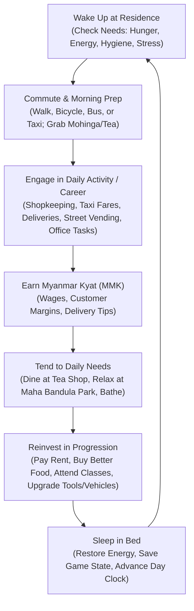
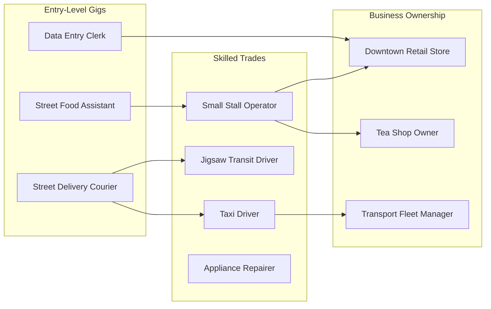
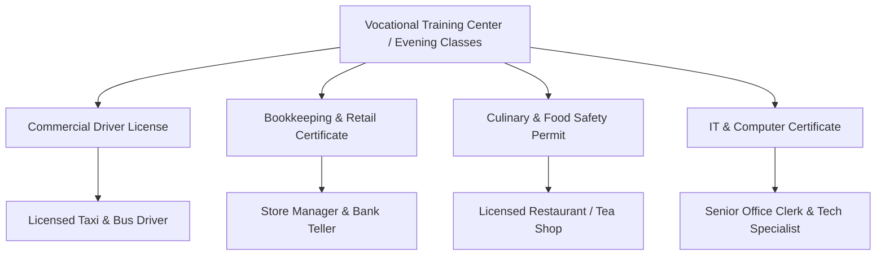

# Game Design Document (GDD) — Yangon Life (ရန်ကုန် ဘဝ)

---

## 1. Game Vision & Pillars
**Yangon Life** is a low-poly open-world life simulation set in the bustling, historic streets of downtown Yangon, Myanmar. 

Players create an ordinary character arriving in the commercial heart of Myanmar with 50,000 Myanmar Kyat (MMK). In a city defined by golden pagoda spires, colonial facades, lively tea shops, and street markets, the player carves out their own livelihood—progressing from a cramped hostel bunk and entry-level gig work to becoming a thriving shopkeeper, fleet operator, or downtown homeowner.

> [!IMPORTANT]
> **THIS IS A LIFE SIMULATOR, NOT A SHOOTER.**  
> Yangon Life features no guns, military factions, or violent combat. Gameplay centers on work, economic advancement, health management, neighborhood relationships, and urban exploration.

### Core Pillars
1. **Authentic Urban Flavor:** Faithful representation of Yangon's street culture—from morning Mohinga stalls and plastic tea-shop stools to the bells of Sule Pagoda and crowded YBS buses.
2. **Accessible Depth:** Intuitive third-person controls coupled with rich, interwoven simulation layers (Needs, Careers, Economy, Skills, Housing).
3. **Player Autonomy & Growth:** Freedom to choose one's path: earn steady wages as a taxi driver, build a commercial retail empire, master culinary arts, or live a leisurely community-focused life.
4. **Universal Accessibility:** Lightweight low-poly visual style engineered for instantaneous browser play (WebGL2) and complete offline single-player autonomy.

---

## 2. Core Gameplay Loop
The player's daily life follows a natural rhythm of survival, work, expenditure, and long-term investment.

---

## 3. Player Identity & Starting Scenario
- **Background:** The player arrives at Yangon Central Railway Station / Downtown bus terminus with a single suitcase and modest personal savings: **50,000 MMK**.
- **Initial Housing:** A rented bunk in a shared dormitory or budget hostel near Pansodan Street.
- **Immediate Goal:** Find a reliable source of daily income before the weekly rent is due, keep hunger and fatigue at bay, and become familiar with the downtown grid.
- **Long-term Ambition:** Elevate financial standing, purchase vehicles, unlock advanced business ownership, acquire luxury downtown apartments, and gain community prestige.

---

## 4. Character Needs System
The player character possesses four core biological and psychological needs tracked on a 0–100 scale:

| Need | Baseline Range | Decay Rate (per game-hr) | Primary Restoration Source | Impact of Depletion (<15.0) |
|---|---|---|---|---|
| **Hunger** | 0 (Starving) to 100 (Full) | -6.0 / hr | Street food stalls, tea shops, grocery cooking | Movement speed slowed by 25%; work efficiency drops 30%; health drain if reaches 0 |
| **Energy** | 0 (Exhausted) to 100 (Rested) | -4.0 / hr (accelerates when sprinting/cycling) | Sleeping in bed, resting on park benches, drinking tea/coffee | Sprinting disabled (`can_sprint() == false`); work efficiency drops 40%; random blackout if reaches 0 |
| **Hygiene** | 0 (Filthy) to 100 (Clean) | -2.5 / hr (accelerates with physical labor) | Bathing in residential bathroom, public washhouse | NPCs refuse polite conversation; shop customers tip less; social reputation penalty |
| **Stress** | 0 (Tranquil) to 100 (Overwhelmed) | +1.5 / hr (grows during long shifts/bad debt) | Maha Bandula Park leisure, chinlone, tea shop chatting, pagoda reflection | Work productivity halved; error rates increase; sleep quality degraded |

### Mechanics Details
- **Game Clock Scaling:** 1 real second = 1 game minute (1 real minute = 1 game hour; a full 24-hour cycle lasts 24 real minutes).
- **Work Efficiency Formula:**
  $$\text{Efficiency} = 1.0 \times (\text{Hunger} < 30 ? 0.7 : 1.0) \times (\text{Energy} < 30 ? 0.6 : 1.0) \times (\text{Stress} > 70 ? 0.8 : 1.0)$$
- **Emergency State (Blackout):** If Energy drops to 0, the player collapses from exhaustion, wakes up 4 hours later in a clinic or hostel bed, and incurs a medical transport fee (15,000 MMK).

---

## 5. Career System
Careers provide both immediate cash flow and long-term career advancement. Players can work salaried shifts, gig-based tasks, or entrepreneurial businesses.

### Career Profiles

#### 1. Shopkeeper (Corner Kiosk / Convenience Store)
- **Role:** Purchase wholesale goods (drinks, snacks, betel nut, basic toiletries), arrange them on shop shelving, price merchandise, and ring up transactions for neighborhood NPCs.
- **Key Gameplay:** Monitoring inventory levels, adjusting prices based on morning vs. evening demand, and handling customer checkout minigames.
- **Progression:** Start with a leased wooden sidewalk kiosk (5m²), expand to a ground-floor colonial shophouse, hire staff to automate shelf stocking.

#### 2. Taxi Driver
- **Role:** Drive across the downtown grid picking up pedestrian passengers flagged by roadside hailing icons.
- **Key Gameplay:** Navigation through traffic, avoiding collisions, monitoring fuel levels, choosing optimal routes, passenger conversation to increase tips.
- **Vehicle Requirement:** Start by renting a beat-up compact sedan per shift (12,000 MMK/day rent); save up to buy a personal vehicle to keep 100% of metered fares.

#### 3. Delivery Worker (Courier)
- **Role:** Pick up food packets from restaurants or parcel boxes from delivery depots and deliver them to downtown addresses within a countdown timer.
- **Transportation:** Start on foot with limited payload; progress to a bicycle (faster, drains Energy), then an electric scooter or motorbike.
- **Key Gameplay:** Route optimization, shortcut navigation through colonial back-alleys, maintaining parcel condition.

#### 4. "Jigsaw" / Shared Feeder Transit Driver
> [!NOTE]
> **Concept Clarification:** In Myanmar urban and suburban transit, light trucks (such as Dyna, Hilux, or Suzuki Carry pickups fitted with bench seating and canvas canopies, colloquially called *Dyna*, *Pick-up*, or *Jigsaw* routes) act as vital feeder transit carrying commuters along designated sub-corridors between neighborhoods and main arterial bus interchanges.
- **Role:** Drive a small passenger truck along a fixed circular route through downtown and neighboring quarters.
- **Key Gameplay:** Stopping at designated passenger muster points, waiting for passenger loads (8–12 passengers), collecting cash fares (500–1,000 MMK per passenger), and keeping to a route schedule.
- **Income Dynamic:** High volume, steady income; requires maintaining vehicle suspension and paying municipal route operating permits.

#### 5. Street Food Vendor (Mohinga / Snack Stall)
- **Role:** Set up a pushcart near high-pedestrian zones (bus stops, park corners, office alleys).
- **Key Gameplay:** Stock fresh broth, noodles, crispy fritters, and boiled eggs. Prepare dishes quickly during the morning rush hour (06:00–09:30) and afternoon tea time (15:00–18:00).
- **Risks:** Unsold perishable food spoils if kept past 24 hours; monsoon rain reduces foot traffic.

#### 6. Office / Technology Worker
- **Role:** Work clerical or freelance digital jobs at commercial centers, banks, or cyber cafés.
- **Key Gameplay:** Mini-tasks involving invoice reconciliation, data entry, English-Burmese document translation, and web maintenance. Low physical energy drain, but steady stress accumulation.

---

## 6. Business Management System
Players who amass capital can transition from workers to business owners:
- **Commercial Leases:** Secure monthly leases for street stalls, ground-floor shophouse spaces, or market stalls at Bogyoke Market.
- **Wholesale Supply Chains:** Travel to wholesale depots near the Yangon River docks or suburban wholesale markets to buy merchandise at 40–60% below retail value.
- **Pricing Strategy:** Set markup percentages (e.g., 20% markup sells quickly; 50% markup yields higher profit per unit but deters budget-conscious NPCs).
- **Staffing:** Hire AI shop assistants for a weekly salary to run the cash register while the player manages multiple locations or explores the city.
- **Store Reputation:** Clean floors, well-stocked shelves, and fast service elevate customer footfall by up to 250%.

---

## 7. Economy & Myanmar Kyat (MMK)
The game utilizes a realistic relative economy anchored around Myanmar Kyat (MMK).

### Economic Benchmarks (Approximate Baseline)
| Item / Service | Typical Cost (MMK) | Category |
|---|---|---|
| Cup of Laphet-yay (Sweet Tea) | 1,000 MMK | Daily Need / Stress Reduction |
| Bowl of Mohinga with fritters | 2,500 MMK | Daily Need / High Hunger Recovery |
| YBS Bus Fare (single trip) | 500 MMK | Public Transport |
| Short Taxi Ride (1–2 km) | 4,000 – 6,000 MMK | Rapid Transit |
| Shared Hostel Bunk (1 week rent) | 35,000 MMK | Budget Housing |
| Partitioned Room in Shophouse (1 month rent) | 180,000 MMK | Moderate Housing |
| Used Commuter Bicycle | 85,000 MMK | Capital Asset |
| Second-Hand 125cc Motorbike | 1,200,000 MMK | Capital Asset |
| Used Compact Sedan (Taxi-ready) | 14,000,000 MMK | Major Career Asset |
| Average Hourly Wage (Entry Delivery/Clerk) | 3,000 – 5,000 MMK / hr | Income |
| Average Shift Profit (Taxi / Food Stall) | 35,000 – 65,000 MMK / shift | Income |

### Financial Infrastructure
- **Cash Wallet:** Physical money carried on hand. Used for street food, informal transactions, bus fares, and tip payments. If blacked out, 10% of cash on hand may be lost.
- **Bank Account (KBZ / CB / AYA style):** Safe deposit accessible via ATMs and mobile phone app. Stores large balances, earns weekly interest (0.1%), and pays recurring apartment rent automatically.
- **Financial Planning:** Budgeting tools on the smartphone app track weekly expenses against gross earnings.

---

## 8. Skills & Education System
Skills represent the character's competencies, growing through active practice and formal education.

### Core Skills
1. **Driving (Levels 1–10):** Improves vehicle handling, increases fuel efficiency, unlocks faster taxis, passenger vans, and delivery trucks.
2. **Customer Service (Levels 1–10):** Increases NPC tips by 5% per level, speeds up checkout minigames, defuses customer disputes.
3. **Business Management (Levels 1–10):** Grants wholesale discounts (up to 20%), reduces staff wage overhead, unlocks higher-tier loan limits.
4. **Cooking (Levels 1–10):** Unlocks culinary recipes, increases hunger saturation of cooked food, enables gourmet menu items.
5. **Repair & Maintenance (Levels 1–10):** Allows repairing vehicles and home appliances yourself, cutting repair shop expenses and enabling freelance repair side gigs.
6. **Tech & Literacy (Levels 1–10):** Unlocks faster data processing gigs, computer repair, and freelance software translation.
7. **Physical Fitness (Levels 1–10):** Increases base stamina, slows energy decay during physical labor, boosts sprint speed.
8. **Charisma & Negotiation (Levels 1–10):** Reduces apartment lease deposits, unlocks unique dialogue choices, accelerates friendship with downtown regulars.

---

## 9. Housing & Residential Progression
Housing serves as the player's personal base: saving the game, resting to restore energy, storing personal inventory, and hosting social gatherings.

| Housing Tier | Type | Monthly Rent / Cost | Rest Quality | Storage | Features |
|---|---|---|---|---|---|
| **Tier 1** | Shared Hostel Bunk (Downtown) | 120,000 MMK / mo | Poor (+25 Energy/hr) | 1 Locker (10 slots) | Shared washroom, high ambient noise |
| **Tier 2** | Partitioned Room in Colonial Shophouse | 250,000 MMK / mo | Standard (+40 Energy/hr) | 1 Wardrobe (25 slots) | Private room, shared kitchen/bath, fan cooling |
| **Tier 3** | Studio Apartment (Pansodan / Anawrahta) | 550,000 MMK / mo | Good (+60 Energy/hr) | 2 Cabinets (50 slots) | Private bathroom, kitchenette, balcony, air conditioning |
| **Tier 4** | 2-Bedroom Downtown Apartment | 1,200,000 MMK / mo | Excellent (+80 Energy/hr) | Walk-in (100 slots) | Full kitchen, laundry, furniture customization, living room |
| **Tier 5** | Restored Heritage Shophouse Ownership | 95,000,000 MMK (Buyout) | Maximum (+100 Energy/hr) | Unlimited | Zero rent, ground floor commercial storefront, rooftop garden |

---

## 10. Transportation & City Navigation
Yangon's downtown has a distinct transit rhythm:
- **Pedestrian:** Sidewalks with street stalls, covered colonnades offering shelter from tropical sun and monsoon downpours.
- **Bicycles & Electric Scooters:** Agile navigation through narrow side-streets; requires moderate stamina.
- **Motorbikes:** Quick commuter transit (with local downtown regulatory zones observed).
- **Metered Taxis:** Hailed anywhere along main avenues; fast direct transport for a metered fee.
- **YBS (Yangon Bus Service):** Low-cost transit running along arterial corridors (Sule Pagoda Road, Maha Bandula Road, Bogyoke Road). Players wait at bus shelters, board on arrival, and pay 500 MMK.
- **Personal Vehicles:** Cars, pickup trucks, and delivery vans with customizable liveries, fuel tanks, and maintenance meters.

---

## 11. Social Systems & NPC Relationships
Downtown Yangon is populated by diverse NPC archetypes: street vendors, office commuters, monks, retirees enjoying the park, and neighborhood shopkeepers.

- **Relationship Values (0–100):**
  - *Stranger (0–19):* Basic greetings, standard commercial transactions.
  - *Acquaintance (20–49):* Friendly small talk, minor trade discounts (2–5%).
  - *Friend (50–79):* Invites to meals, alerts about lucrative gig opportunities, emergency loan assistance.
  - *Close Confidant (80–100):* Business partnership opportunities, access to discounted property rentals, exclusive recipes.
- **Community Reputation:** A positive neighborhood reputation earned by helping neighbors, keeping clean shopfronts, and fair pricing unlocks community trust, lowering shop theft and increasing foot traffic.

---

## 12. Leisure & Cultural Activities
Restoring the mind is as essential as earning an income:
- **Maha Bandula Park Leisure:** Stroll around the Independence Monument, read a newspaper under tropical shade trees, watch the fountain, and recover stress.
- **Chinlone (Cane Ball) Circles:** Join informal afternoon games of Myanmar's traditional sport in public plazas to build physical fitness and bond with locals.
- **Tea Shop Culture (Laphet-yay Hsaing):** Sit on low plastic stools with sweet Burmese milk tea, fried samosas, and Chinese steamed buns (*bao*). Listen to neighborhood gossip and radio news.
- **Spiritual Reflection:** Visit the historic Sule Pagoda, offer water or flowers at daily planetary posts, practice mindful walking meditation, and significantly reduce character stress.

---

## 13. NPC Simulation & Daily Schedules
NPCs follow life schedules driven by a simulated daily timetable rather than existing as static props:

### Distance-LOD Optimization
- **LOD 0 (Within 50m of Player):** Full 3D skinned character mesh, blend-tree locomotion, active inverse kinematics, line-of-sight awareness, real-time collision.
- **LOD 1 (50m to 150m):** Simplified rigid mesh, low-frequency position updates, path-follower navigation along sidewalks without individual avoidance physics.
- **LOD 2 (Beyond 150m):** Pure background schedule simulation. NPCs update their abstract location grid cell based on scheduled clock events without rendering 3D nodes.

---

## 14. Dynamic World & City Simulation
- **Day/Night Cycle:** 24 real-time minutes per in-game day (1 sec = 1 min).
  - *Dawn (05:00–07:00):* Soft morning light, monastery chimes, street sweepers, Mohinga vendors igniting charcoal stoves.
  - *Midday (11:00–14:00):* Harsh overhead tropical sunlight, high heat index (accelerates thirst and hygiene decay).
  - *Evening (17:00–19:30):* Golden hour, street lamps ignite, neon signs flicker on, heavy commuter traffic.
  - *Night (20:00–04:00):* Quiet residential streets, nightlife around food corridors, cooler ambient temperatures.
- **Weather System:**
  - *Sunny / Hot:* High heat index, increases energy and hygiene drain, stimulates cold drink sales.
  - *Monsoon Downpour:* Heavy tropical rain, wet pavement shaders, pedestrians opening umbrellas, increased taxi demand, reduced sidewalk foot traffic.
  - *Overcast:* Moderate temperatures, ideal for outdoor labor and bicycle transit.
- **Traffic Simulation:** Stylized low-poly Yangon city buses, sedans, and light trucks navigate a downtown waypoint network, adhering to traffic lights and yielding to crossing pedestrians.

---

## 15. Progression Model
The player's journey unfolds across five distinct lifestyle phases:

1. **Phase 1: Surviving the Streets (Days 1–7):** Living in a shared hostel bunk. Working gig courier deliveries and street food shifts. Learning the street map and maintaining baseline needs.
2. **Phase 2: Steady Work & Private Space (Weeks 2–4):** Renting a partitioned room in an Anawrahta shophouse. Earning a commercial driver's license. Operating a rented taxi or running a leased sidewalk kiosk.
3. **Phase 3: Small Enterprise (Month 2):** Opening a permanent downtown grocery store or tea shop. Purchasing a private commuter motorbike. Enrolling in evening accounting courses.
4. **Phase 4: Commercial Expansion (Months 3–6):** Upgrading to a spacious studio apartment on Pansodan Road. Hiring employees to run retail shops. Owning a taxi or pickup truck.
5. **Phase 5: Established Citizen (Month 6+):** Buying out a heritage shophouse property. Managing a fleet of delivery vehicles or multiple shops. Attaining peak civic reputation.

---

## 16. Game Modes
1. **Mode A — Offline Single-Player:** The primary, fully featured experience. All managers run locally in the client; saves are written to local JSON files. Zero internet connectivity needed.
2. **Mode B — Online Multiplayer (4–8 Players):** Cooperative urban simulation where friends live in the same Yangon district. Players can patronize each other's stores, trade goods, carpool, and participate in community events. Economy is authoritative to prevent balance exploitation.
3. **Mode C — Browser Play (WebGL2):** Exported as a WebAssembly/WebGL2 application playable directly in modern browsers without installation, featuring complete feature parity with single-player mode.

---

## 17. Scope Boundaries & Phased Rollout
To guarantee exceptional polish, depth, and performance:
- **Phase 1 (Initial Release):** Downtown Core Slice (~1km x 1km) centered on Sule Pagoda, extending north to Bogyoke Aung San Road, east to Pansodan Road, south to Strand Road, and west to Shwedagon Pagoda Road.
- **Phase 2 (Subsequent Expansion):** Chinatown (19th Street food corridor), Indian Quarter, and the Yangon Riverfront jetties.
- **Phase 3 (Long-term Expansion):** Dagon Township (surrounding the Shwedagon Pagoda complex) and Kandawgyi Lake recreational area.
