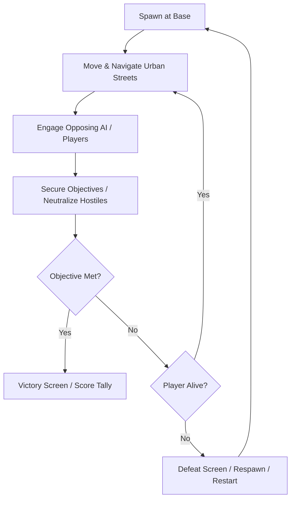

# Game Design Document (GDD) — Yangon Frontline

## 1. Game Vision
**Yangon Frontline** is an intense, tactical, low-poly urban first-person shooter set in a fictionalized downtown Yangon, Myanmar. Players navigate colonial-era boulevards, shop-lined alleys, and urban choke points in fast-paced firefights.

The game is built with three core pillars:
1. **Accessibility & Portability:** Instant browser playability (WebGL2) and zero-friction offline single-player.
2. **Tactical Urban Gameplay:** Tight street angles, cover-to-cover navigation, responsive shooting mechanics, and distinct weapon handling.
3. **Cohesive Low-Poly Style:** Stylized Yangon aesthetics, warm faded concrete, iconic street signs, balconies, market stalls, and distinctive faction silhouettes.

---

## 2. Opposing Factions
The game represents fictionalized opposing factions within an entertainment-oriented combat experience:
- **MILITARY:** Fictionalized conventional military force.
  - *Visual Identity:* Olive drab and dark green tactical helmets, body armor vests, structured silhouettes.
  - *UI Color:* Deep Blue / Slate (`#2A4D69`).
- **PDF (People's Defence Force):** Fictionalized local urban resistance.
  - *Visual Identity:* Casual urban apparel with tactical chest rigs, red or checkered armbands, bandana/caps.
  - *UI Color:* Crimson / Vermillion (`#D9381E`).

---

## 3. Core Gameplay Loop

---

## 4. Player Abilities & Mechanics
- **Locomotion:** Smooth WASD movement, momentum, sprint with weapon bob, jump, and ground friction.
- **Weapon Handling:** Aim-down-sights (ADS) with FOV zoom, weapon recoil impulse and recovery, tactical reload.
- **Health System:** 100 base HP, directional damage indicators, temporary invulnerability frames on respawn.
- **Interaction:** Objective capture zones, doors/barricades, ammo pickups.

---

## 5. Weapon Design (Prototype to Full Arsenal)
| Weapon | Type | Damage | Mag Size | Fire Rate | Recoil Profile | Effective Range |
|---|---|---|---|---|---|---|
| **MA-1 Vanguard** (Assault Rifle) | Automatic | 24 HP | 30 rounds | 600 RPM | Moderate vertical with slight horizontal drift | Medium (35m) |
| **P-9 Tactical** (Sidearm) | Semi-Auto | 20 HP | 15 rounds | 400 RPM | Low kick, rapid recentering | Short (15m) |
| **BA-63 Marksman** (Rifle) | Semi-Auto | 65 HP | 10 rounds | 180 RPM | High vertical kick, slow recovery | Long (75m) |

*M1 Prototype Weapon:* **MA-1 Vanguard Assault Rifle** with raycast hit detection, procedural recoil, muzzle flash, ammo HUD, and reload mechanics.

---

## 6. AI Systems Design
- **Factions & Perception:** AI agents belong to either MILITARY or PDF. Vision cone (90-degree FOV, 30m range, line-of-sight raycast check).
- **Behavioral States:**
  - `IDLE`: Stationed at defensive spot or looking around.
  - `PATROL`: Waypoint navigation along urban sidewalk/street routes.
  - `ALERT / INVESTIGATE`: Moves toward gunshots or detected player location.
  - `COMBAT`: Stoppage, strafing, burst firing, and seeking nearest cover.
  - `DEAD`: Ragdoll or collapse animation, disabling collision and processing.

---

## 7. Urban Map Design (Yangon Downtown Slice)
- **Map Boundaries:** Surrounding colonial tenements and military roadblocks creating a balanced 60m x 40m prototype arena.
- **Features:**
  - Main 2-lane road with cracked asphalt and road divider.
  - Colonial shuttered buildings with verandas and overhanging balconies.
  - Ground-floor tea shops (Laphet-yay signs, low plastic stools, wooden tables).
  - Power poles with tangled overhead cables, street lamps, and tropical palm planters.
  - Concrete roadblocks, sandbag nests, and a parked bus providing natural tactical cover.

---

## 8. Target Audience & Scope Boundaries
- **Audience:** Tactical FPS fans seeking accessible, browser-friendly or lightweight offline military shooter gameplay.
- **Scope Boundaries:** Focus on tight urban skirmishes (4–8 players or solo vs bots). No large-scale vehicular combat or aerial strikes in initial phases.
