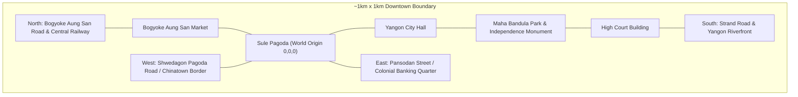
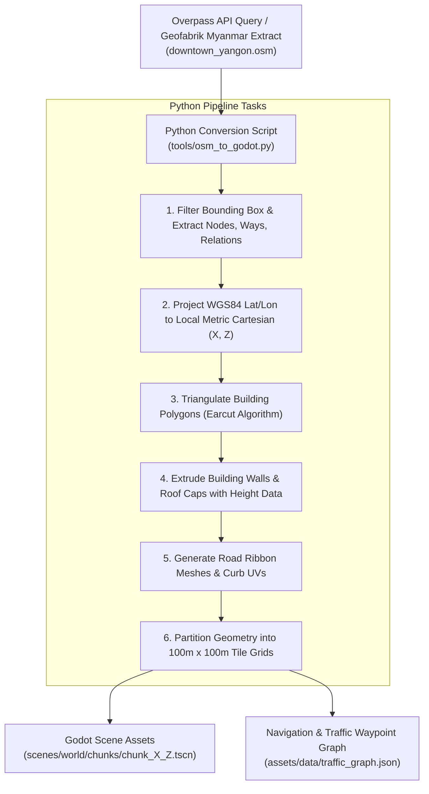
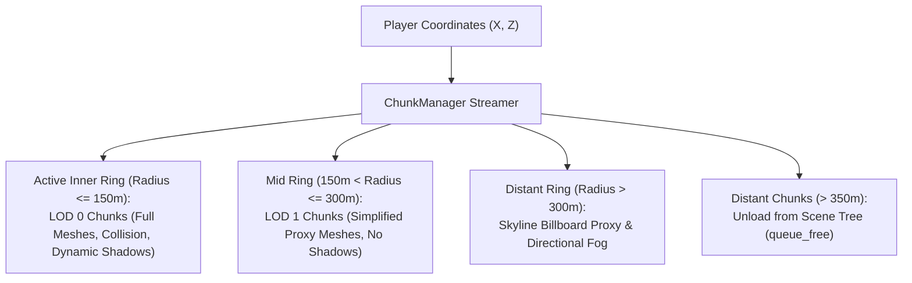

# Geographic Map Data Strategy — Yangon Life (ရန်ကုန် ဘဝ)

---

## 1. Strategy Overview & Core Principles
**Yangon Life** is built upon real-world geographic data representing the historic downtown core of Yangon, Myanmar. 

To deliver a faithful urban sense of place while honoring performance and licensing mandates, the project adopts three core spatial principles:
1. **Open Data Foundation:** Exclusively utilizes **OpenStreetMap (OSM)** data under open, permissive licensing.
2. **Pre-Baked Offline Geometry:** 100% of the world geometry, road networks, building footprints, and navigation meshes are extracted and pre-baked into Godot scene assets during build time. The game makes zero runtime network calls to map servers.
3. **Cartesian Game Projection:** Real-world WGS84 geographic coordinates (latitude and longitude) are mathematically projected into a local metric 3D Cartesian coordinate system with **Sule Pagoda** as the origin `(0, 0, 0)`.

---

## 2. Source Selection & Legal Licensing

### Why OpenStreetMap (OSM) Over Google Maps?
| Consideration | OpenStreetMap (OSM) | Google Maps Platform |
|---|---|---|
| **Legal License** | Open Database License (ODbL 1.0) | Proprietary Commercial Terms of Service |
| **Offline Game Asset Baking** | **Permitted:** ODbL explicitly allows extracting vector nodes/polygons and packaging derivative 3D meshes inside game files. | **Strictly Prohibited:** Google Maps Platform ToS Section 3.2.3 explicitly forbids caching, extracting, or storing map content for offline use, reverse engineering, or asset bundling in video games. |
| **Licensing Fees** | 100% Free / Open Source community data. | High per-request enterprise API costs and restrictive usage tiers. |
| **Data Customization** | Complete access to raw XML/PBF tags (`building:levels`, `shop=*`, `highway=*`, `amenity=*`). | Limited proprietary vector access; closed attributes. |

### Licensing Compliance & Attribution Requirements
OpenStreetMap is open data licensed under the **Open Database License (ODbL)** by the OpenStreetMap Foundation (OSMF).
- Under the terms of the ODbL, extracting building footprints and street centerlines to generate 3D geometric game assets constitutes a **Produced Work**.
- **Mandatory Attribution:** The project provides explicit, clear attribution in all user-facing documentation and in-game credit screens:
  > **"Map data © OpenStreetMap contributors, licensed under the Open Database License (ODbL)."**
  > Link: [https://www.openstreetmap.org/copyright](https://www.openstreetmap.org/copyright)
- In-game attribution is displayed on the initial title splash screen, the in-game City Map overlay (`M` key), and in the Credits menu.

---

## 3. Geographic Coordinate System & Projection Math

### Reference Datum & World Origin
The world origin `Vector3(0.0, 0.0, 0.0)` in Godot is anchored directly at the central stupa of the historic **Sule Pagoda**:
- **Reference Latitude ($\phi_0$):** $16.7735^\circ\text{ N}$ ($16.773500^\circ$)
- **Reference Longitude ($\lambda_0$):** $96.1581^\circ\text{ E}$ ($96.158100^\circ$)
- **Reference Elevation ($h_0$):** $8.0\text{ meters above mean sea level}$

```
               North (-Z)
                   ▲
                   │
                   │   City Hall
                   │      │
West (-X) ◄────────┼──────┴──────► East (+X)
              Sule Pagoda
               (0, 0, 0)
                   │
                   │   Maha Bandula Park
                   │      │
                   ▼
               South (+Z)
```

### Godot 3D Coordinate Mapping
Godot Engine utilizes a right-handed 3D Cartesian coordinate system with `Y` pointing up:
- **`+X` Axis (East):** Measures displacement eastward in meters.
- **`-X` Axis (West):** Measures displacement westward in meters.
- **`+Y` Axis (Up):** Elevation above ground level in meters.
- **`-Z` Axis (North):** Measures displacement northward in meters.
- **`+Z` Axis (South):** Measures displacement southward in meters.

### Equirectangular Metric Projection Formula
Because the initial playable downtown area spans approximately $1\text{ km} \times 1\text{ km}$ ($0.01^\circ$ delta), the Earth's surface can be modeled as a local planar tangent with negligible distortion:

$$\Delta \phi = \text{radians}(\phi - \phi_0)$$
$$\Delta \lambda = \text{radians}(\lambda - \lambda_0)$$
$$R_{\text{earth}} = 6,378,137.0\text{ meters}$$

$$\text{Local X (East)} = R_{\text{earth}} \times \Delta \lambda \times \cos(\text{radians}(\phi_0))$$
$$\text{Local Z (South)} = -(R_{\text{earth}} \times \Delta \phi) \times (-1) = R_{\text{earth}} \times (\phi_0 - \phi) \times \frac{\pi}{180}$$
$$\text{Local Y (Up)} = \text{Elevation} - h_0$$

At Yangon's latitude ($\phi_0 = 16.7735^\circ$):
- $1^\circ\text{ Longitude} \approx 106,620\text{ meters}$ ($1\text{ meter} \approx 0.000009379^\circ$)
- $1^\circ\text{ Latitude} \approx 110,650\text{ meters}$ ($1\text{ meter} \approx 0.000009038^\circ$)

---

## 4. Initial Playable Boundaries (Downtown Yangon Core)
The initial milestone scope is centered on the historic downtown grid, spanning a radius of approximately 500 meters from Sule Pagoda (~$1\text{ km}^2$ total area):

| Boundary | Landmark / Road | Geographic Coordinate | Game Coordinate (X, Z) |
|---|---|---|---|
| **North Boundary** | Bogyoke Aung San Road / Central Railway Line | $16.7785^\circ\text{ N}$ | $Z \approx -553\text{ m}$ (North) |
| **South Boundary** | Strand Road & Yangon Riverfront | $16.7685^\circ\text{ N}$ | $Z \approx +553\text{ m}$ (South) |
| **West Boundary** | Shwedagon Pagoda Road / 29th Street | $96.1530^\circ\text{ E}$ | $X \approx -544\text{ m}$ (West) |
| **East Boundary** | Pansodan Street / Bo Aung Kyaw Street | $96.1635^\circ\text{ E}$ | $X \approx +576\text{ m}$ (East) |



### Key Landmarks Within Initial Scope
1. **Sule Pagoda (ဆူးလေဘုရား):** Octagonal golden stupa at the central roundabout; world origin `(0, 0, 0)`.
2. **Yangon City Hall (ရန်ကုန်မြို့တော်ခန်းမ):** Distinctive syncretic Burmese architecture featuring traditional *pyatthat* tiered roofs.
3. **Maha Bandula Park (မဟာဗန္ဓုလပန်းခြံ):** Central public recreational lawn containing the 150-foot Independence Monument obelisk.
4. **High Court Building:** Iconic Victorian-era British colonial red-brick landmark with clock tower.
5. **Bogyoke Aung San Market (ဗိုလ်ချုပ်အောင်ဆန်းစျေး):** Historic cobblestone shopping arcade hosting gemstone, handicraft, and clothing stalls.
6. **Pansodan Heritage Corridor:** Historic banking and trading houses showcasing grand 19th-century colonial facades and verandas.

---

## 5. Extracted OSM Feature Types & Tag Mappings

### Road Network (`highway=*`)
| OSM Highway Tag | Game Classification | Road Width (m) | Sidewalk Width (m) | Traffic Speed |
|---|---|---|---|---|
| `highway=primary` (Sule Pagoda Rd) | 4-lane arterial boulevard | 16.0m | 3.5m covered colonnade | 45 km/h |
| `highway=secondary` (Maha Bandula Rd) | 3-lane commercial avenue | 12.0m | 3.0m sidewalk | 40 km/h |
| `highway=tertiary` (Pansodan St) | 2-lane urban street | 9.0m | 2.5m sidewalk | 35 km/h |
| `highway=residential` (Numbered Streets) | 1-lane narrow urban corridor | 6.0m | 1.8m sidewalk | 25 km/h |
| `highway=pedestrian` / `highway=footway` | Pedestrianized plaza / alley | 4.0m – 6.0m | Full pedestrian zone | 0 (No cars) |

### Building Footprints (`building=*`)
- **Tags Captured:** `building=yes`, `building=apartments`, `building=commercial`, `building=retail`, `building=civic`.
- **Height Determination Logic:**
  1. If `height=*` is tagged, parse explicit height in meters.
  2. If `building:levels=*` is tagged, calculate: $\text{Height} = \text{levels} \times 3.2\text{ meters}$.
  3. Default fallback for downtown Yangon colonial shophouses: 4 stories ($12.8\text{ meters}$).
- **Burmese Architectural Color Palette:** Buildings are textured with procedural low-poly material palettes:
  - Faded yellow / ochre plaster
  - Aged colonial white / cream lime wash
  - British red brick with white keystones
  - Weathered jade green and sky blue window shutters

### Parks, Vegetation & Water Bodies
- **`leisure=park` / `landuse=grass`:** Converted to flat green terrain meshes with scattered tropical low-poly tree assets (palm trees, banyan trees, frangipani).
- **`natural=water` / `waterway=riverbank`:** Yangon River boundary generated along the southern perimeter with animated low-poly water surface shader.
- **`amenity=place_of_worship`:** Triggers hero landmark asset placement (Sule Pagoda, Immanuel Baptist Church, Bengali Sunni Jameh Mosque).

---

## 6. Data Conversion Pipeline (`osm_to_godot.py`)

The extraction and conversion pipeline operates entirely offline during development:



### Python Conversion Script Structure
Located at `D:\Games\ygn frontier\tools\osm_to_godot.py`:
- **Libraries Used:** `osmapi` or `xml.etree.ElementTree`, `numpy`, `mapbox-earcut` (for robust concave polygon triangulation).
- **Input:** Raw OSM XML file `assets/raw_data/downtown_yangon.osm`.
- **Output:** Godot scene files (`.tscn`) containing `MeshInstance3D` nodes and simplified `StaticBody3D` collision boxes.

---

## 7. Procedural Geometry Generation

### Roads and Sidewalks
- **Road Mesh:** Generated as continuous quad strips along OSM way nodes. UV coordinates map seamlessly to a road atlas texture containing asphalt, white lane dividers, and yellow curbs.
- **Sidewalks & Gutters:** Sidewalks are extruded $0.15\text{ m}$ above the road surface, complete with curb chamfers and storm drainage grates common in Yangon.
- **Crosswalks (Zebra Crossings):** Automatically generated where pedestrian footpaths intersect arterial highways.

### Buildings & Shophouses
- **Extrusion:** 2D footprint polygons are triangulated for roof caps and extruded downward to form exterior walls.
- **Street-Level Shopfronts:** Ground-floor facade sections facing streets have doorway indentations and colorful canvas awnings procedurally attached.
- **Colliders:** To maximize performance on WebGL2, buildings use simplified convex collision hulls or compound box colliders rather than complex trimesh collisions.

### Hero Landmark Overrides
While generic shophouses are procedurally extruded from OSM footprints, iconic landmarks are replaced with hand-crafted low-poly hero models:
- `sule_pagoda.tscn`: Detailed golden stupa, entrance stairways (*zaungdan*), and prayer pavilions.
- `yangon_city_hall.tscn`: Custom tiered Burmese roof finials and peacock motifs.
- `independence_monument.tscn`: Fluted central obelisk with five surrounding satellite pillars.

---

## 8. Runtime Performance & Streaming Architecture

To ensure silky-smooth 60 FPS performance on both desktop systems and low-end WebGL2 browser canvases:



### 100m x 100m Tile Grid
- The downtown area is divided into a regular grid of tiles named `chunk_X_Z.tscn` (e.g., `chunk_0_0.tscn` for Sule Pagoda, `chunk_1_0.tscn` for City Hall / Maha Bandula Park).
- **Occlusion & Frustum Culling:** Godot's built-in portal/occlusion system hides shophouses occluded behind closer buildings along street corridors.
- **Batching & Materials:** Buildings share a single master texture atlas palette with vertex colors, keeping draw calls under 80 for the entire downtown scene.

---

## 9. Map Maintenance & Expansion Workflow
1. **Source Tracking:** Raw OSM extracts are archived with an explicit version timestamp in `assets/raw_data/osm_version.json`.
2. **Re-running Pipeline:** When expanding downtown boundaries or updating road alignments, run:
   ```powershell
   python "D:\Games\ygn frontier\tools\osm_to_godot.py" --bbox "16.768,96.152,16.779,96.164" --output "scenes/world/chunks/"
   ```
3. **Verification:** Inspect generated scenes in Godot headless mode and verify collision alignment with unit test scripts.
