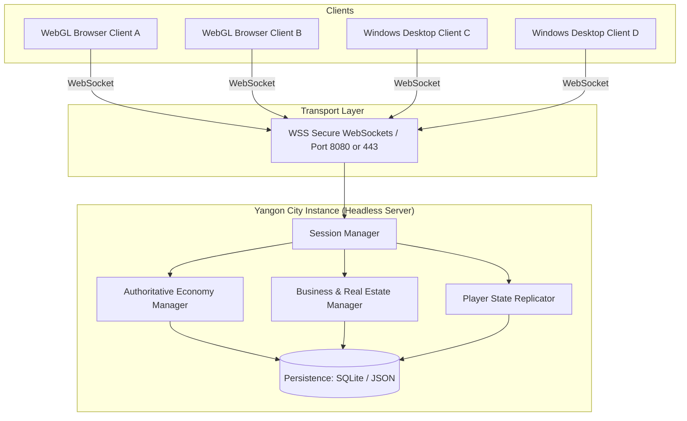
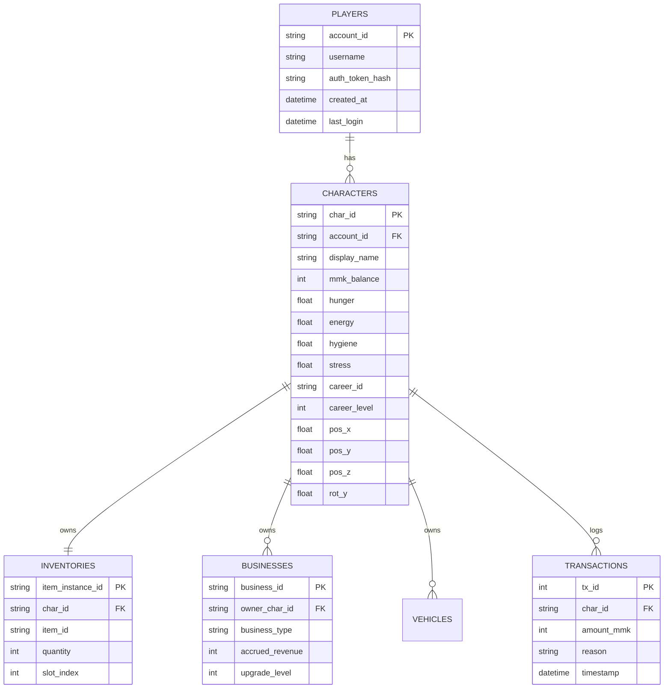

# Multiplayer Architecture & Networking Specification — Yangon Life

**Project:** Yangon Life  
**Document Version:** 2.0.0  
**Last Updated:** 2026-10-19  
**Status:** Approved Specification  

---

## 1. Executive Summary & Networking Philosophy

**Yangon Life** is an open-world low-poly life simulation set in downtown Yangon, Myanmar. Unlike twitch-based first-person shooters, life simulations prioritize:
- **Persistence & Economic Integrity:** Preventing currency counterfeiting, unauthorized item duplication, and invalid property transfers.
- **Cross-Platform Accessibility:** Providing seamless play across native Windows desktop executables and zero-install HTML5/WebGL2 browser clients.
- **Social Presence & Low Latency Sensitivity:** Player movement and social interactions tolerate normal internet latency (100–250ms), allowing lightweight synchronization models.
- **Low Operational Overhead:** Running cost-effectively on small VPS instances without prohibitive infrastructure costs.

---

## 2. Network Topology & Protocols



### 2.1 Topology
- **Architecture:** Client-Server authoritative topology. Peer-to-peer (P2P) is strictly prohibited to protect the virtual economy and prevent cheating.
- **Transport Protocol:** WebSockets (`WebSocketMultiplayerPeer` in Godot or standard WebSocket protocol over TLS `wss://`). WebSockets provide 100% feature parity between browser clients (which cannot open raw UDP sockets) and native desktop binaries.
- **Port Allocation:** 
  - Standard development port: `8080` (TCP/WebSocket).
  - Production port: `443` (WSS proxied through Nginx/Caddy reverse proxy with SSL termination).

### 2.2 Instance Sizing & Boundaries
- **Instance Capacity:** 4 to 8 players per city instance (downtown Yangon district shard).
- **World Partitioning:** Each instance simulates a downtown Yangon sector (centered around Sule Pagoda, Maha Bandula Park, and surrounding grid avenues).
- **Player Density:** 4–8 concurrent players provides vibrant social co-presence at cafes, teashops, delivery routes, and retail shops while keeping network bandwidth, memory, and CPU limits well within lightweight hosting parameters.

---

## 3. Server Architecture Options

The server architecture supports two interchangeable backends:

| Feature | Option A: Headless Godot 4.7 Server | Option B: Node.js WebSocket Server |
|---|---|---|
| **Runtime** | `godot --headless --path ...` | Node.js (v20+ LTS) / TypeScript |
| **Logic Sharing** | Shares 100% of GDScript logic with client | Re-implements economy & validation rules in JS/TS |
| **Physics Simulation** | Full Godot 3D physics collision checks | Bounding box / 2D plane grid math |
| **Memory Footprint** | ~180MB - 250MB RAM per 8-player instance | ~60MB - 110MB RAM per 8-player instance |
| **Ideal Phase** | Prototype to Beta (immediate code sharing) | Scaled Production (maximum density per VPS) |

For current development and milestone targets, **Option A (Headless Godot 4.7 Server)** is the primary reference implementation due to shared codebase efficiency.

---

## 4. Authority Matrix & Validation Rules

To protect game integrity, authority is distributed under a strict **Zero-Trust Client** model:

| Game Domain | Client Authority | Server Authority | Synchronization Method |
|---|---|---|---|
| **Player Position & Orientation** | Predicts locally; sends movement input & target position | Validates max velocity, obstacles, teleportation; reconciles | 20 Hz periodic snapshot (`unreliable_ordered`) |
| **Wallet & Currency (MMK)** | UI display only; requests transaction | Authoritative balance; deducts/credits; signs receipt | Reliable RPC on event (`reliable`) |
| **Inventory & Items** | UI display; sends request to consume/use/transfer | Validates item existence, ownership, capacity, and durability | Reliable RPC on event (`reliable`) |
| **Career & Wages** | Performs mini-game/task; requests shift completion | Verifies work duration, task criteria, and dispenses MMK | Server timer & shift validation |
| **Business Ownership** | Requests purchase/management | Maintains title deeds, hires, prices, passive revenue calculation | Server database |
| **Vehicle Driving** | Client claims driver seat; simulates vehicle physics | Approves driver lock; synchronizes vehicle position to peers | Driver sends 20 Hz transform; server broadcasts |
| **NPC Pedestrians & Traffic** | Simulates visual walking and local pathing | Broadcasts major world events and shared state | Local deterministic generation + server sync seeds |
| **Day/Night & Weather** | Renders skybox, shaders, and light direction | Authoritative global clock and weather state | Broadcast at state transition or 0.1 Hz |

---

## 5. Synchronization Model

### 5.1 Player Kinematics (20 Hz)
- **Send Rate:** 20 updates per second (every 50ms) per client.
- **Packet Contents:**
  ```json
  {
    "tick": 14205,
    "position": [124.5, 0.5, -82.3],
    "yaw": 182.4,
    "pitch": 0.0,
    "anim_state": "WALK_CARRYING",
    "velocity": [2.4, 0.0, 1.1]
  }
  ```
- **Interpolation:** Remote clients receive kinematic snapshots and use Hermite/Cubic interpolation with a small jitter buffer (75–100ms) to ensure butter-smooth character animation without micro-stuttering.

### 5.2 NPC Simulation (Hybrid Local-Authoritative Model)
- **Rationale:** Sending transform updates for 50–100 ambient Yangon street pedestrians and taxis at 20 Hz would saturate WebSockets and overload browser memory.
- **Solution:** 
  - Ambient pedestrians and traffic follow deterministic path routes driven by localized client-side simulation.
  - When a player interacts with an NPC (e.g., buying tea from a street vendor, hiring a taxi), the interaction generates a server-authoritative event.
  - Vendors and interactive service NPCs have fixed world coordinates synchronized across all clients.

### 5.3 Shared World Events
- Market price fluctuations, weather transitions (tropical Yangon rainstorms, afternoon heat), and municipal announcements are broadcast via lightweight reliable RPCs when triggered.

---

## 6. Economy & Business Synchronization

### 6.1 Server-Authoritative Wallet
- The client wallet (`d:\Games\ygn frontier\scripts\economy\economy_manager.gd`) is completely overridden in multiplayer mode by server state.
- Every purchase follows a two-phase commit:
  1. **Client Request:** `rpc_id(1, "request_purchase", item_id, vendor_id)`
  2. **Server Verification:**
     - Does the player have sufficient MMK?
     - Is the player within interaction distance (<= 3.5m) of the vendor?
     - Does the vendor have the item in stock?
     - Does the player have inventory capacity?
  3. **Server Execution:** Balance is decremented on server, database writes transaction record, server notifies client with updated balance and inventory payload.
  4. **Client Response:** UI updates upon receiving server confirmation. If rejected, client UI plays error tone with rejection reason (e.g., `"Insufficient MMK"`).

### 6.2 Business Ownership & Revenue Generation
- Players can purchase storefronts (e.g., Kyauktada Betel Nut Kiosk, Pabedan Tea Stall, Merchant Street Convenience Store).
- **Server-Side Revenue Ticks:**
  - Revenue calculates on an authoritative server cron tick (every 10 in-game minutes / 2 real-world minutes).
  - Formula: `Revenue = BaseRevenue * EconomyModifier * Upgrades - OperatingExpenses`.
  - Earnings accumulate into the business escrow account regardless of whether the owner is currently logged in.
  - Upon login, the owner receives a `"Business Earnings Report"` and can collect accrued MMK.

---

## 7. Persistence & Database Strategy

### 7.1 Storage Architecture
For the prototype and testing phases, the server utilizes **SQLite 3** (or atomic JSON storage for lightweight dev testing), isolated on **Drive D:** (`D:\Games\ygn frontier\server\data\yangon_life.db`).

### 7.2 Database Schema Overview



---

## 8. Connection Lifecycle, Reconnection & Disconnect Handling

### 8.1 Graceful Disconnect
- Player presses **"Quit to Menu"** or **"Log Out"**.
- Client sends `disconnect_notify`.
- Server flushes player state, inventory, and location to database.
- Server broadcasts despawn RPC to peer clients.
- Server terminates WebSocket session.

### 8.2 Ungraceful Disconnect & Reconnection Window
- When a connection drops due to browser tab closure, network dropout, or Wi-Fi instability:
  1. **Ghost Hold Period (60–120 seconds):** The server retains the player's session token and character avatar in the world (character enters an `INACTIVE` idle stance).
  2. **Reconnection Window:** If the client reconnects within 120 seconds with the matching session token, they immediately resume control of their avatar without state loss.
  3. **Timeout Expiry:** If the timer reaches 120 seconds with no reconnect, the server:
     - Commits full character state to SQLite.
     - Removes the avatar from the world scene.
     - Frees the session slot for new connecting players.

---

## 9. Sequence Diagram: Join, Play, and Disconnect Flow

```mermaid
sequenceDiagram
    autonumber
    actor Player as Client (Browser/Desktop)
    participant S as Authoritative Server
    participant DB as Persistence DB (Drive D:)
    actor Peer as Other Players in Instance

    Note over Player, S: 1. Connection & Authentication
    Player->>S: WebSocket Connect(Token, ClientVersion)
    S->>DB: Query Player Account & Character State
    DB-->>S: Return Character Data (MMK: 50,000, Needs, Inventory)
    S-->>Player: Connection Accepted (Assigned PeerID, WorldState)
    S-->>Peer: Broadcast "PlayerJoined" (Spawn Remote Puppet)
    Peer-->>S: Acknowledge Spawn

    Note over Player, S: 2. Core Gameplay & Movement Loop (20Hz)
    loop Every 50ms
        Player->>S: SendKinematics(Position, Yaw, AnimState)
        S->>S: Validate Kinematics (Speed & Boundary Check)
        S-->>Peer: Broadcast Snapshot(PeerID, Position, Yaw, Anim)
    end

    Note over Player, S: 3. Server-Authoritative Economic Transaction
    Player->>S: request_purchase(Item: "mohinga_bowl", Cost: 2500 MMK, VendorID: "tea_stall_01")
    S->>S: Validate: Dist <= 3.5m, Balance (50,000 >= 2,500), Inventory Slot Open
    S->>DB: Update Balance: 47,500 MMK; Insert Inventory Item
    DB-->>S: Transaction Committed
    S-->>Player: purchase_confirmed(NewBalance: 47,500, ItemAdded: "mohinga_bowl")
    Player->>Player: Update Wallet HUD, Play SFX, Add Item to Bag

    Note over Player, S: 4. Disconnection & State Preservation
    alt Graceful Exit
        Player->>S: notify_disconnect()
        S->>DB: Flush Full Character State (Needs, Location, Inventory)
        S-->>Peer: Broadcast "PlayerLeft" (Despawn Remote Puppet)
        S->>Player: Close WebSocket
    else Ungraceful Dropout (Network Drop / Browser Close)
        S->>S: Detect Socket Heartbeat Timeout (5s)
        S->>S: Start 120s Reconnection Grace Window
        opt Reconnected within 120s
            Player->>S: WebSocket Reconnect(Existing Session Token)
            S-->>Player: Resume State Confirmed
        end
        opt Grace Window Expired (>120s)
            S->>DB: Persist Character State & Free Instance Slot
            S-->>Peer: Broadcast "PlayerLeft"
        end
    end
```

---

## 10. Security Model & Anti-Tamper Measures

1. **Zero Client Trust:**
   - Client balances, inventory counts, and prices are strictly display values.
   - All arithmetic (`balance - price`, `salary + reward`) happens on the server.
2. **Transaction Rate-Limiting:**
   - Clients are limited to a maximum of 3 financial requests per second.
   - Rapid-fire transaction requests trigger a `429 Too Many Requests` network penalty and temporary cooldown.
3. **Movement & Speed Validation:**
   - The server computes the Euclidean distance between consecutive player position updates:  
     $$\Delta d = ||\vec{P}_{t} - \vec{P}_{t-1}||$$
   - If $\frac{\Delta d}{\Delta t} > \text{MaxSpeed} \times \text{Tolerance}$ (e.g., $8.0\,\text{m/s} \times 1.25$), the server snaps the player back to their last valid position, rejecting speedhacking and wall clipping.
4. **Distance Checks for Interactions:**
   - Any interaction with shops, ATMs, vehicles, or work stations requires the player to be within radius (typically 3.0m - 5.0m).

---

## 11. Hosting, Infrastructure & Cost Analysis

| Component | Specification | Estimated Cost |
|---|---|---|
| **Virtual Private Server (VPS)** | 1 vCPU, 1 GB – 2 GB RAM, 25 GB SSD (e.g., Hetzner Cloud CX22 or DigitalOcean Droplet) | ~$4.00 – $6.00 / month |
| **Domain & DNS** | Standard TLD with Cloudflare free tier DNS | ~$10.00 / year (~$0.83 / month) |
| **SSL / TLS Certificate** | Let's Encrypt (automated via Caddy or Certbot) | Free ($0.00) |
| **Static Web Hosting** | GitHub Pages, Cloudflare Pages, or served directly from VPS | Free ($0.00) |
| **Total Monthly Cost** | **Complete Small-Scale Testing Environment** | **~$5.00 – $7.00 / month** |

### Memory Sizing Breakdown
- **Base OS (Debian 12 minimal):** ~80 MB RAM.
- **Headless Godot Server Process (1 city shard, 8 players):** ~180 MB – 250 MB RAM.
- **Node.js Alternative Server:** ~70 MB – 110 MB RAM.
- **SQLite Footprint:** Negligible (< 15 MB RAM cache).
- **Result:** A single 2 GB RAM VPS can comfortably run up to **4 to 6 concurrent city shards** (32 to 48 concurrent players) without resource contention.

---

## 12. Verification & Testing Strategy

1. **Local Dual-Client Test:**
   - Launch server headlessly: `& "D:\Tools\Godot\godot.cmd" --headless --path "D:\Games\ygn frontier" -- --server --port 8080`.
   - Launch Client A (Desktop) and Client B (Browser).
   - Verify movement replication at 20 Hz.
   - Verify purchase at a tea stall by Client A is reflected in Client A's wallet and recorded on server.
2. **Packet Loss & Latency Simulation:**
   - Test client simulation stability under 150ms synthetic latency and 2% packet loss using browser network throttling tools.
3. **Disconnect Recovery Test:**
   - Force kill Client A process; observe server enter 120s reconnection grace window.
   - Reopen Client A within 60s; verify seamless re-association with character.
