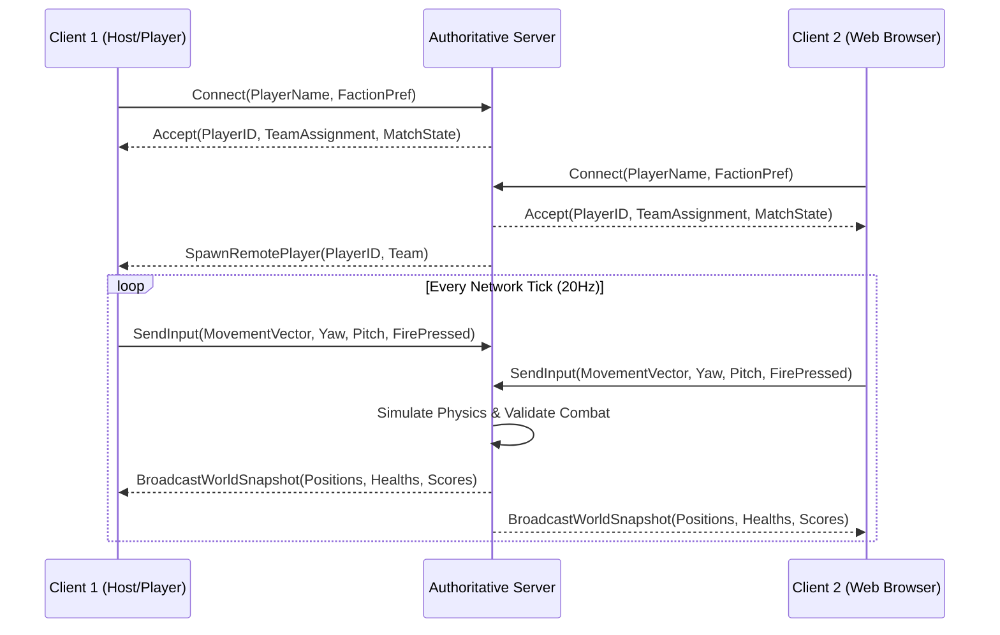

# Multiplayer Architecture & Networking Specification — Yangon Frontline

## 1. Networking Model & Topology
- **Topology:** Client-Authoritative Input / Server-Authoritative State.
- **Protocol:** WebSockets (`WebSocketMultiplayerPeer`) allowing seamless cross-play between Windows desktop executables and HTML5/WebGL browser clients.
- **Tick Rates:**
  - Server Simulation Rate: 30 Hz.
  - Client Network Send Rate: 20 Hz (Position, Orientation, Input flags).
  - Snapshot Broadcast Rate: 20 Hz.

---

## 2. Server Responsibilities & Anti-Cheat Authority
Clients are considered completely untrusted. The authoritative server is solely responsible for:
1. **Damage & Hit Resolution:** Clients report a `fire_request(origin, direction, timestamp)`. The server traces the bullet raycast against player hitbox histories (lag compensation up to 200ms) to confirm hits.
2. **Health, Death & Respawning:** Only the server decrees player health subtraction, death events, and spawn coordinates.
3. **Ammo Validation:** Server decrements ammo on valid shots and rejects firing when magazine is empty.
4. **Movement Validation:** Speed and clipping validation to prevent speedhacking and teleportation.

---

## 3. Session Lifecycle & Match Flow

---

## 4. Message Formats & Serialization
All network packets use compact binary serialization via Godot's built-in `PackedByteArray` or high-level Multiplayer API RPCs (`@rpc("any_peer", "call_remote", "unreliable_ordered")`).

---

## 5. Hosting & Operational Architecture
- **Server Runtime:** Headless Godot binary running in a lightweight Linux Docker container (`alpine` or `debian-slim`).
- **RAM Footprint:** ~180MB RAM per 8-player match instance.
- **Estimated Operational Cost:** A basic $5/mo cloud VPS (1 vCPU, 2GB RAM) can easily host 8 concurrent active matches (64 simultaneous players).
