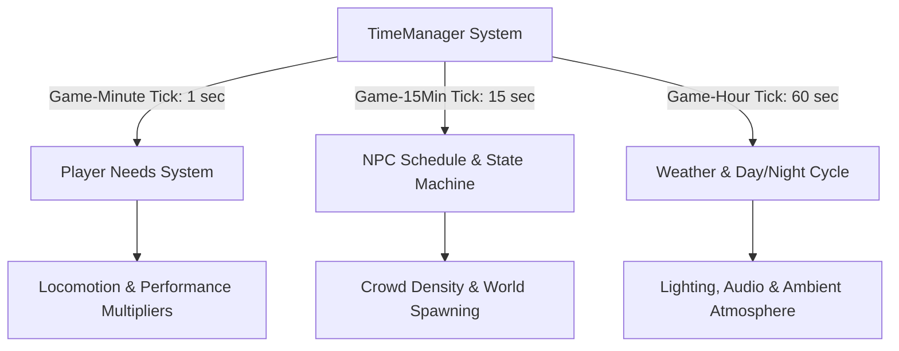
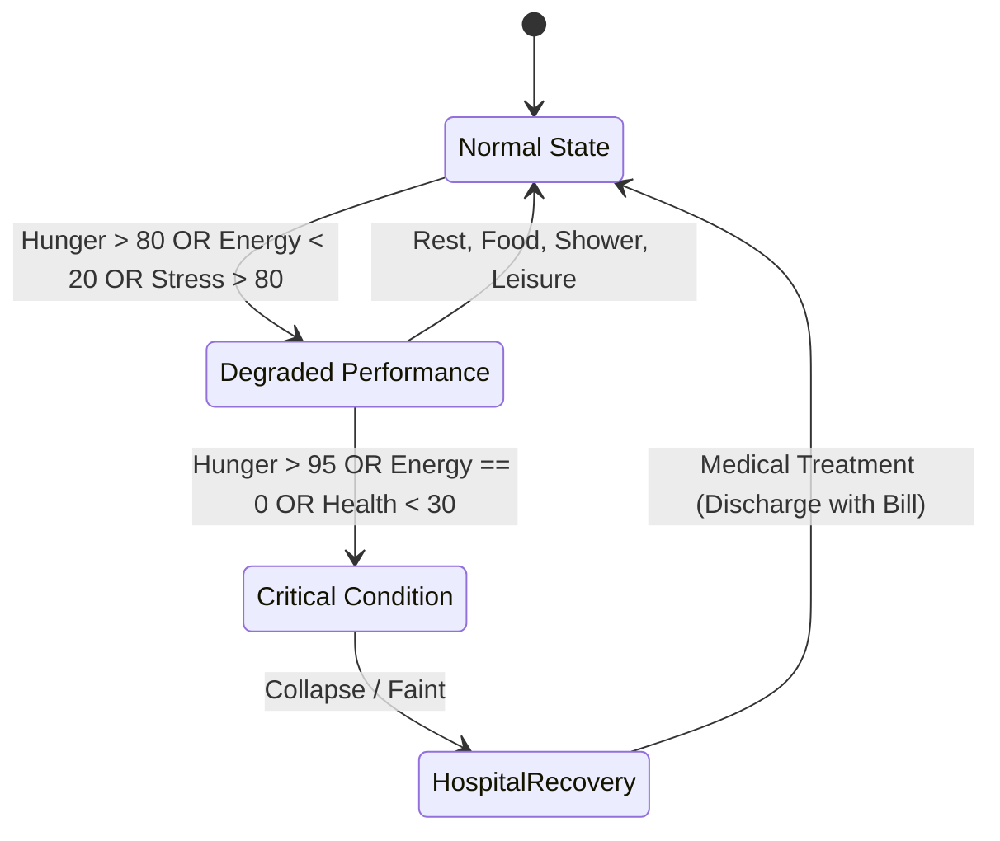
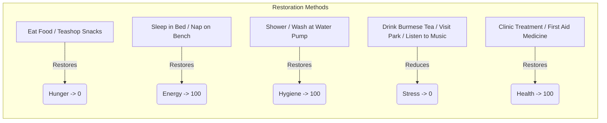
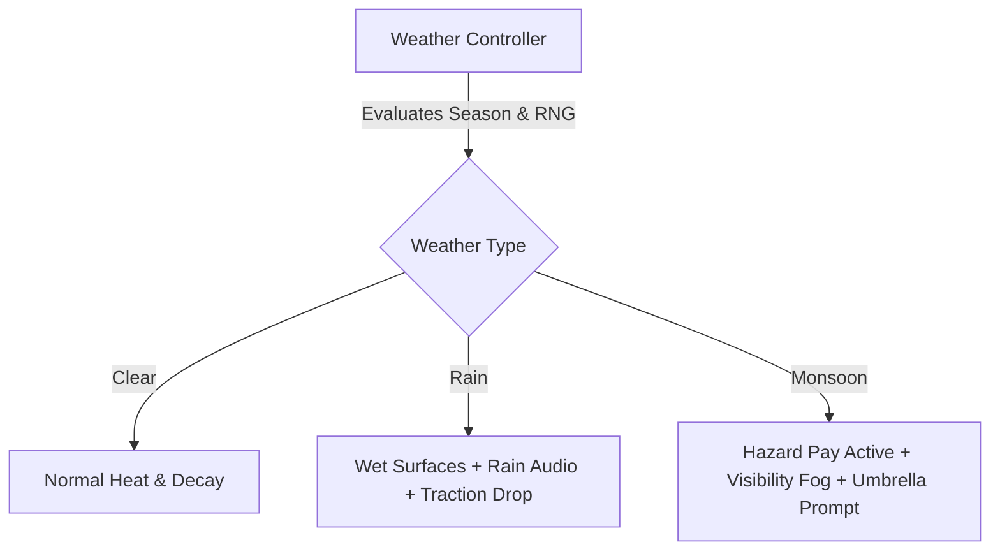
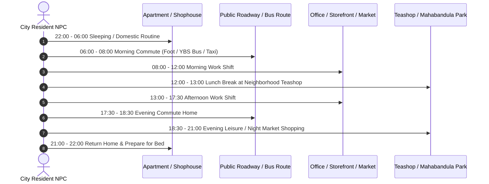
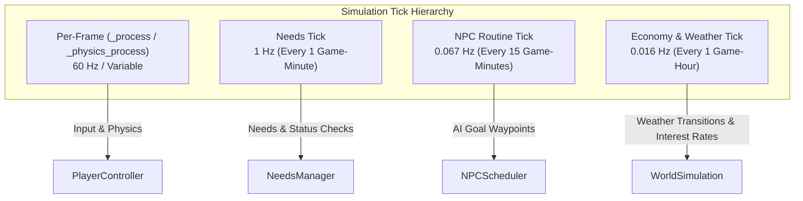

# Simulation Systems — Yangon Life

## 1. System Architecture Overview

**Yangon Life** operates on a modular, tick-driven simulation model where biological needs, environmental conditions, temporal progression, and NPC schedules interact seamlessly. The simulation is decoupled from graphic rendering frame rates, ensuring identical simulation fidelity across standalone desktop, headless server, and browser (WebGL2) environments.



---

## 2. The Needs System

The player character possesses five core physiological and psychological attributes. All attributes are normalized between `0.0` and `100.0`.

### 2.1. Needs Matrix & Decay Rates

| Need | Scale | Base Decay Rate | Critical Threshold | Direct Gameplay Impact When Neglected |
|---|---|---|---|---|
| **Hunger** | `0` (Satiated) to `100` (Starving) | `+15.0` per game-hour | `> 80.0` | **Energy regeneration penalty (-50%)**, health loss begins at `> 95.0`, audible stomach rumbling, screen vignetting. |
| **Energy** | `100` (Rested) to `0` (Exhausted) | `-8.0` per game-hour | `< 20.0` | **Inability to sprint**, movement speed capped at 65%, heavy breathing, random eyelid droop effect, passing out at `0.0`. |
| **Health** | `100` (Optimal) to `0` (Incapacitated) | `0.0` (Decays only via severe starvation or disease) | `< 30.0` | Slower interaction speed, blurred peripheral vision. If `0.0`, player collapses and wakes up in Yangon General Hospital. |
| **Hygiene** | `100` (Clean) to `0` (Filthy) | `-5.0` per game-hour (Accelerates during physical labor or monsoon heat) | `< 25.0` | Visual flies/odor particle effect, NPCs refuse service in upscale restaurants/offices, shop prices penalize messy appearance by 15%. |
| **Stress** | `0` (Relaxed) to `100` (Burnout) | Increases dynamically during high-intensity shifts, traffic congestion, and prolonged low needs | `> 80.0` | **Reduced work performance (salary penalty -25%)**, decreased skill progression rate, twitching UI reticle. |



---

## 3. Needs Recovery Mechanisms

Every need has dedicated interactive methods for restoration available across Yangon:



### 3.1. Detailed Recovery Methods
- **Eating & Hydration:**
  - *Mohinga / Noodles / Rice:* Recovers 35 – 70 Hunger points.
  - *Fresh Coconuts / Sugarcane Juice:* Recovers 15 Hunger, reduces 10 Stress, provides a 3-hour hydration buff.
  - *Cold Bottled Water:* Cleanses dry throat, slows energy decay by 15% in hot weather.
- **Sleep & Rest:**
  - *Bed in Leased Apartment:* Recovers 100 Energy over 7-8 game hours; provides "Well-Rested" buff (+10% skill gain for 12 game hours).
  - *Nap on Park Bench / Vehicle Seat:* Recovers 20-30 Energy over 2 game hours (hygiene penalty -5, small risk of light theft if in unlit alley).
- **Hygiene & Sanitation:**
  - *Apartment Bathroom Shower:* Restores Hygiene to 100 in 15 in-game minutes.
  - *Neighborhood Public Water Spout (Tu-Paung):* Restores Hygiene to 60 (modest cost or free, outdoor public setting).
- **Stress Relief & Recreation:**
  - *Teashop Hangout (Laphet-Yay Sitting):* Sipping sweet tea with friends reduces Stress by 25 points per 30 minutes.
  - *Strolling Mahabandula Park:* Strolling in greenery or sitting near the Sule Pagoda reduces Stress by 20 points per hour.
  - *Listening to Radio / Playing Phone Games:* Light stress reduction during commute or downtime.

---

## 4. Time System & Day/Night Cycle

The game uses a compressed real-time simulation model:

### 4.1. Time Scaling
- **Default Conversion Rate:** `1 real-world minute = 1 game-hour` (configurable in `TimeConfig.gd`).
- **Complete Game Day:** `24 real-world minutes = 1 game day (24 hours)`.
- **Game Minute Duration:** `1 real-world second = 1 game-minute`.

```
+-------------------------------------------------------------------------------+
|                             24-HOUR GAME CYCLE                                |
| 00:00        06:00 (Sunrise)      12:00 (Noon)       18:00 (Sunset)     24:00 |
| [--- Night ---] [--- Morning ---] [--- Afternoon ---] [--- Evening ---] [Night]
| Ambient: Dark | Ambient: Golden   | Ambient: Bright  | Ambient: Orange  | Dark|
+-------------------------------------------------------------------------------+
```

### 4.2. Day/Night Cycle Transitions
- **06:00 (Sunrise):** Sunlight shifts from deep indigo (`#1E2238`) through warm gold (`#E8A855`) to crisp daylight. Streetlights turn off, morning markets come alive, Buddhist monks walk morning alms rounds.
- **12:00 (Midday):** Peak sun angle, highest heat, sharpest shadows. Increased energy and hydration decay rate.
- **18:00 (Sunset):** Golden hour hues, sky transitions to twilight crimson and purple. Colonial streetlights and pagoda illumination beacons ignite. Night food stalls open.
- **22:00 – 05:00 (Night):** Low ambient light, diminished traffic, quiet backstreets, increased security presence near commercial banks.

---

## 5. Weather System

Yangon's tropical climate features dynamic weather profiles that influence both visual fidelity and simulation mechanics.

| Weather State | Probability (Dry Season) | Probability (Monsoon) | Visual & Audio Characteristics | Gameplay & Needs Modifiers |
|---|---|---|---|---|
| **Clear** | 70% | 15% | Bright tropical sun, light high-altitude clouds, crisp shadows. | Normal decay rates. High midday sun slightly accelerates energy/hygiene decay. |
| **Cloudy** | 20% | 25% | Diffused soft shadows, grey-blue sky, mild breeze. | Baseline decay rates. Ideal conditions for outdoor courier deliveries and foot transit. |
| **Rain** | 8% | 40% | Moderate rainfall, road puddles with specular reflections, pitter-patter audio. | Foot traction slightly reduced, vehicle stopping distance +20%, street vendor NPC traffic drops -30%, outdoor hygiene decay stops. |
| **Heavy Rain (Monsoon)** | 2% | 20% | Torrential downpour, thunder claps, low visibility fog, water pooling on streets. | Pedestrian sprint disabled, vehicle slip increased +45%, outdoor stress increases +5/hour without umbrella, delivery payout rates gain +35% "Rain Bonus". |



---

## 6. NPC Schedules & Life Simulation

Non-Player Characters (NPCs) in Yangon Life adhere to believable daily routines, simulating the pulse of a living Southeast Asian metropolis.



### 6.1. NPC Archetypes
1. **Office Commuter:** Downtown-focused, adheres strictly to the 08:30 – 17:30 schedule, frequents bakeries and transit hubs.
2. **Market Hawker / Street Merchant:** Early riser (05:00 setup), trades all day until 16:00, or night market vendor (17:00 – 23:00).
3. **Student:** Departs toward universities or high schools at 07:30, studies until 15:30, clusters in cafes and stationery shops in late afternoon.
4. **Buddhist Monk / Novitiate:** Walks morning alms route in silent procession between 06:30 and 08:30; returns to monastery for study and meditation.

### 6.2. Player Daily Routines
- The game suggests structured routines (e.g., morning tea, fixed job shifts, evening grocery runs) through work reminders and calendar notifications on the smartphone.
- **Player Freedom:** Routines are entirely optional. Players are free to be nocturnal night-owls, full-time delivery riders working 14-hour stretches, or freelance entrepreneurs setting their own timetable.

---

## 7. Simulation Tick Architecture

To maximize CPU efficiency and ensure smooth 60 FPS performance on WebGL2 / low-end hardware, the simulation uses tiered update intervals:



| Subsystem | Frequency | Interval (Real Time) | Responsibilities |
|---|---|---|---|
| **Physics & Player Controller** | Every frame (`_physics_process`) | ~16.6 ms (60 FPS) | Movement, raycasts, collision, camera spring-arm, vehicle physics. |
| **Player Needs System** | Every game-minute | Exactly `1.0` second | Apply hunger/energy/hygiene decay, check critical threshold triggers, update HUD bars. |
| **NPC Schedule Evaluator** | Every 15 game-minutes | Exactly `15.0` seconds | Check NPC routine transitions, update pathfinding targets for off-screen NPCs, rebalance crowd density. |
| **Weather & Environment** | Every game-hour | Exactly `60.0` seconds | Interpolate sky colors, roll weather probability tables, trigger rain particle emission transitions. |
| **Financial Ledger** | Every game-day midnight | Exactly `24.0` minutes | Process shop rent amortizations, business payrolls, bank interest, utility bills. |

---

## 8. GDScript Technical Implementation Reference

```gdscript
# File: res://scripts/systems/NeedsComponent.gd
class_name NeedsComponent
extends Node

signal need_changed(need_type: StringName, current_value: float)
signal need_critical(need_type: StringName, severity: StringName)

@export var hunger: float = 0.0: set = _set_hunger
@export var energy: float = 100.0: set = _set_energy
@export var health: float = 100.0: set = _set_health
@export var hygiene: float = 100.0: set = _set_hygiene
@export var stress: float = 0.0: set = _set_stress

# Base decay per game-hour (scaled by tick delta)
const HUNGER_DECAY_PER_HOUR: float = 15.0
const ENERGY_DECAY_PER_HOUR: float = 8.0
const HYGIENE_DECAY_PER_HOUR: float = 5.0

func tick_game_minute(game_minutes_elapsed: float) -> void:
	var hours: float = game_minutes_elapsed / 60.0
	hunger = clampf(hunger + (HUNGER_DECAY_PER_HOUR * hours), 0.0, 100.0)
	energy = clampf(energy - (ENERGY_DECAY_PER_HOUR * hours), 0.0, 100.0)
	hygiene = clampf(hygiene - (HYGIENE_DECAY_PER_HOUR * hours), 0.0, 100.0)
	
	_evaluate_consequences()

func _evaluate_consequences() -> void:
	if hunger > 80.0:
		need_critical.emit(&"hunger", &"warning")
	if energy < 20.0:
		need_critical.emit(&"energy", &"severe")
	if stress > 80.0:
		need_critical.emit(&"stress", &"warning")

func _set_hunger(value: float) -> void:
	hunger = value
	need_changed.emit(&"hunger", hunger)

func _set_energy(value: float) -> void:
	energy = value
	need_changed.emit(&"energy", energy)

func _set_health(value: float) -> void:
	health = value
	need_changed.emit(&"health", health)

func _set_hygiene(value: float) -> void:
	hygiene = value
	need_changed.emit(&"hygiene", hygiene)

func _set_stress(value: float) -> void:
	stress = value
	need_changed.emit(&"stress", stress)
```

This tiered, event-driven design ensures that high simulation depth never compromises CPU performance, allowing tens of active systems to run smoothly across all deployment targets.
