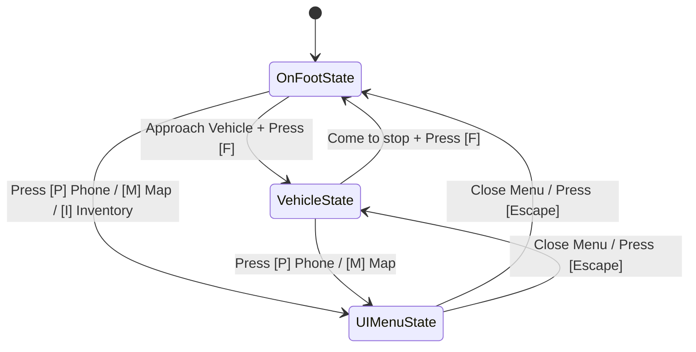
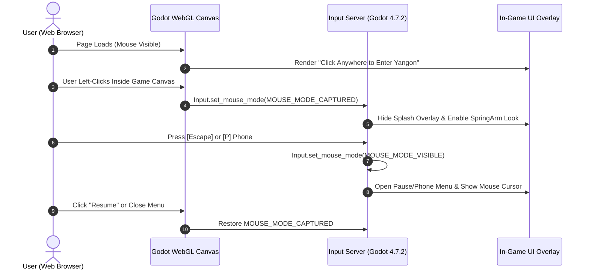

# UI and Controls Specification — Yangon Life

## 1. Control Schemes & Input Mapping

**Yangon Life** features intuitive, responsive third-person controls on foot and seamless transition into vehicular driving. All keybindings support player remapping and dual-mode mouse handling (pointer-lock in third-person camera mode; unlocked cursor when browsing menus and smartphones).

### 1.1. On-Foot Control Scheme

| Action Name | Input (Default Keyboard / Mouse) | Functionality |
|---|---|---|
| `move_forward` | `W` / Up Arrow | Character moves forward relative to camera facing angle |
| `move_backward` | `S` / Down Arrow | Character moves backward relative to camera facing angle |
| `move_left` | `A` / Left Arrow | Character strafes/turns left |
| `move_right` | `D` / Right Arrow | Character strafes/turns right |
| `sprint` | `Shift` (Hold) | Sprint acceleration (consumes energy stamina; disabled if Energy < 20) |
| `jump` | `Space` | Jump over low curbs, sidewalk steps, or market crates |
| `interact` | `E` | Contextual interaction (talk to NPC, examine shop stall, pick up item) |
| `enter_vehicle` | `F` | Enter/exit nearest vehicle (within 2.5m door trigger) |
| `inventory` | `I` or `Tab` | Toggle inventory backpack grid |
| `map` | `M` | Open full Yangon city map view |
| `phone_menu` | `P` | Pull up smartphone multi-app dashboard |
| `pause_menu` | `Escape` | Pause game, release mouse capture, open system settings |
| `camera_look` | `Mouse Motion` | Orbits third-person SpringArm3D camera around player character |
| `camera_zoom` | `Mouse Wheel Up / Down` | Zooms camera distance between 1.5m (close-up) and 6.0m (wide view) |

---

### 1.2. Vehicle Driving Control Scheme

When entering any drivable vehicle (taxi, passenger sedan, delivery scooter, truck) via `F`, the control mapping automatically switches to vehicular physics mode:

| Action Name | Input (Keyboard) | Functionality |
|---|---|---|
| `vehicle_accelerate` | `W` | Engine throttle / accelerate forward |
| `vehicle_brake_reverse`| `S` | Apply footbrake; hold when stationary to reverse |
| `vehicle_steer_left` | `A` | Steer wheels left |
| `vehicle_steer_right` | `D` | Steer wheels right |
| `vehicle_handbrake` | `Space` | Locks rear wheels for tight turns and parking |
| `vehicle_exit` | `F` | Turn off ignition and exit driver's seat |
| `vehicle_horn` | `H` | Honk horn to alert jaywalking NPCs |
| `vehicle_lights` | `L` | Toggle headlights between Off / Low-beam / High-beam |
| `vehicle_radio` | `R` | Cycle Yangon local radio stations / music tracks |



---

## 2. Browser & Pointer Capture Lifecycle

For WebGL2 browser execution (`HTML5 / WebAssembly`), mouse capture follows strict web security standards:



- **Audio Unlock:** The initial click event concurrently initializes the Godot WebAudio context, satisfying browser autoplay policies.
- **Lost Focus Handling:** When the browser tab loses focus or the user alt-tabs, the game automatically pauses and restores cursor visibility.

---

## 3. Heads-Up Display (HUD) Architecture

The in-game HUD provides vital situational awareness without cluttering the screen:

```
+-----------------------------------------------------------------------------------------+
| [Yangon Life v0.1]               [ 14:45 | CLEAR | MON ]               [ 54,200 MMK ]  |
|                                                                                         |
|                                                                                         |
|                                                                                         |
|                                                                                         |
|                                                                                         |
|                                      [E] Speak                                          |
|                               ( Daw Tin Tin - Teashop )                                 |
|                                                                                         |
|                                                                                         |
| [HNG] [====        ] 35%                                                +-------------+ |
| [ENG] [==========  ] 82%                                                |   MINIMAP   | |
| [HYG] [=======     ] 60%                                                |    ( * )    | |
| [STR] [==          ] 15%                                                |   Sule Rd   | |
| [HP ] [============] 100%                                               +-------------+ |
+-----------------------------------------------------------------------------------------+
```

### 3.1. HUD Elements Breakdown
1. **Top-Center (Clock & Weather Widget):**
   - Displays 24-hour in-game clock (`14:45`), current weather icon (`Sun/Rain`), and day of the week.
2. **Top-Right (Financial Balance Widget):**
   - Live Myanmar Kyat balance formatted with comma separators (e.g., `54,200 MMK`).
   - Floats green `+1,500 MMK` or red `-2,500 MMK` animated badges when transactions occur.
3. **Bottom-Left (Needs & Health Gauges):**
   - Compact stacked horizontal bars with status icons:
     - `HNG` (Hunger): Green (`<50%`), Yellow (`50-80%`), Pulsing Red (`>80%`).
     - `ENG` (Energy): Cyan (`>50%`), Amber (`20-50%`), Flashing Red (`<20%`).
     - `HYG` (Hygiene): Light Blue (`>50%`), Brownish Yellow (`<25%`).
     - `STR` (Stress): Slate Blue (`<50%`), Deep Orange (`>80%`).
     - `HP`  (Health): Solid Green (`>50%`), Crimson Red (`<30%`).
4. **Bottom-Center (Contextual Interaction Prompt):**
   - Appears dynamically when within 2.5m of an interactable object/NPC.
   - Shows action key badge `[E]` followed by action verb and target name (e.g., `[E] Order Mohinga - 2,500 MMK`).
5. **Bottom-Right (Minimap Radar):**
   - Circular or rounded-square radar displaying road centerlines, north needle, active waypoint GPS trails, player cone of vision, and nearby POI icons (shops, gas stations, bus stops, quest markers).

---

## 4. Full-Screen Interfaces

### 4.1. Map Screen (`M`)
- **Full Yangon Map Display:** High-resolution vector-rendered downtown map based on OpenStreetMap streets.
- **Waypoints & Markers:** Left-click anywhere to set custom navigation waypoints; GPS route dynamically calculates along the road network.
- **Filterable POIs:** Toggle layers for:
  - Jobs & Employment Agencies
  - Food & Beverage (Teashops, Restaurants)
  - Housing & Leasable Properties
  - Fuel Stations & Vehicle Workshops
  - Cultural & Religious Sites (Sule, Botahtaung, Parks)
- **Fast Travel / Bus Lines:** Clicking a discovered YBS bus stop allows purchasing a transit ticket to any other discovered bus stop.

---

### 4.2. Smartphone Menu (`P`)
The smartphone simulates a modern Burmese Android mobile phone, serving as the player's personal organizer:

```
+-----------------------------+
| 14:45         [4G] [92%]   |
| --------------------------- |
|        YANGON MOBILE        |
|                             |
|  [Career]     [Finances]    |
|   (Jobs)       (Banking)    |
|                             |
|  [Skills]     [Contacts]    |
|  (Academy)     (Phonebook)  |
|                             |
|  [Deliver]    [Settings]    |
|   (App)        (Options)    |
|                             |
| --------------------------- |
| [ O ]       [ < ]     [ || ]|
+-----------------------------+
```

1. **Career App:**
   - Displays active job role, employer, shift hours, current shift earnings, and next promotion requirements.
   - Job Board tab lists vacant positions across Yangon with required skill prerequisites.
2. **Finances & Mobile Banking App (KBZPay / WavePay Style):**
   - Shows cash-in-hand vs. bank account savings balance.
   - Income & Expense Breakdown chart: tracks daily food, rent, fuel, and wages.
   - Business P&L statement tab for owned shops and vehicle fleets.
3. **Skills & Training App:**
   - Visualizes skill levels: `Driving`, `Cooking`, `Mechanics`, `Commerce`, `Negotiation`, `Fitness`, `Diligence`.
   - Enroll in evening vocational training courses.
4. **Contacts & Messaging App:**
   - SMS dialogue history with quest givers, landlords, business suppliers, and friends.

---

### 4.3. Grid-Based Inventory System (`I` or `Tab`)
- **Capacity:** Fixed slot grid (e.g., 20 slots base backpack, expandable to 36 slots with canvas travel bag).
- **Categorized Tabs:** `All`, `Food & Consumables`, `Tools & Equipment`, `Trade Commodities`, `Documents & Keys`.
- **Item Details Card:** Displays item icon, name in English and Burmese script, weight, monetary sell value, hunger/energy restoration stats, and contextual buttons (`Use`, `Drop`, `Split Stack`).

---

### 4.4. Commerce & Shop Interface
- **Dual Column Layout:** Left column shows Merchant Stock (with purchase prices); right column shows Player Inventory (with merchant offer buyback prices).
- **Quantity Selector:** Slider and `+/-` stepper for bulk purchasing (essential for shopkeepers buying wholesale cases of condensed milk, tea leaves, or snacks).
- **Transaction Total Bar:** Displays subtotal, tax/discount rates, and "Confirm Purchase / Sale" button.

---

### 4.5. Settings & Accessibility Menu (`Escape`)
- **Input & Controls:** Mouse sensitivity slider (0.01 to 2.0), Invert Y-axis toggle, full custom key rebinding modal.
- **Audio:** Master volume, Ambient City Sounds, Vehicle SFX, Radio & Music volume sliders.
- **Graphics Quality:** Preset toggles (`Low`, `Medium`, `High`), Render Resolution Scale (50% to 100%), Shadow Quality (`Off`, `Low`, `High`), FOV Slider (60° to 95°).
- **Language / Locale:** English and Myanmar Unicode (Pyidaungsu font).
- **Game Session:** Save Game, Load Game, Restart Day, Exit to Desktop / Main Menu.
