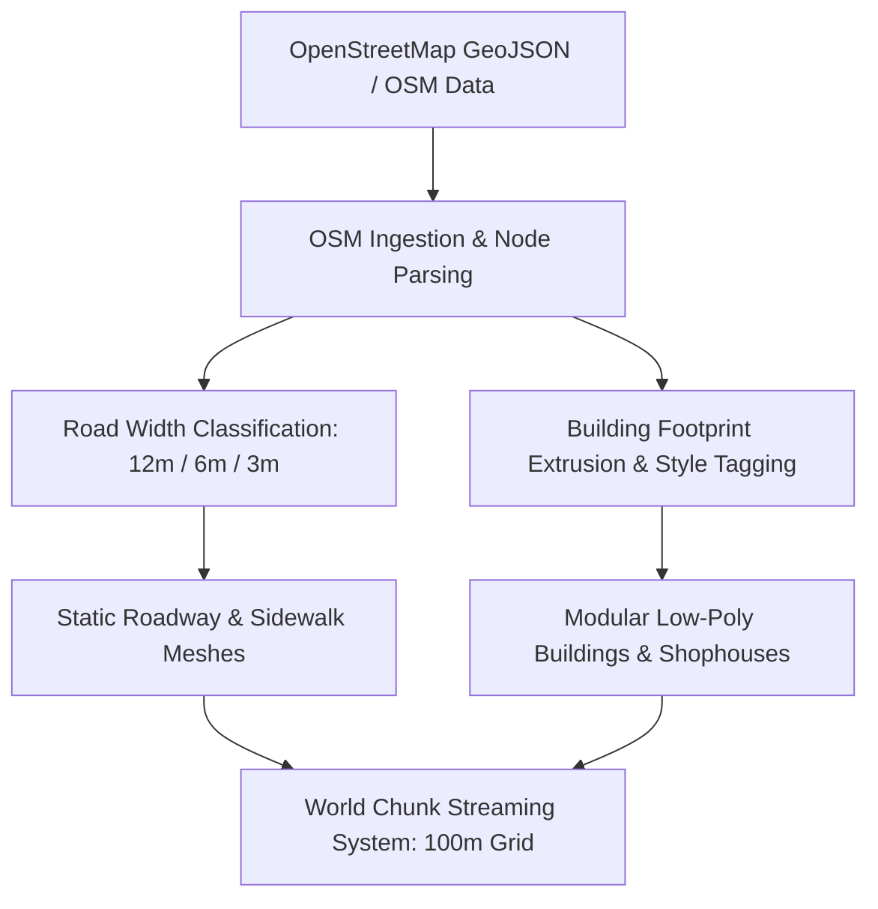
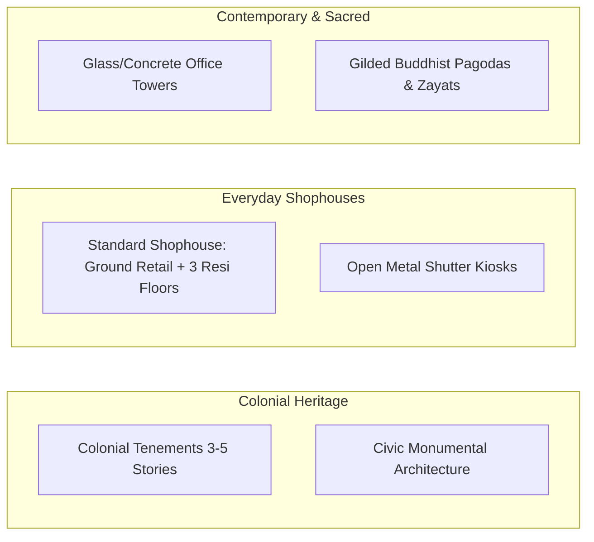

# World Design Specification — Yangon Life

## 1. World Vision & Map Scale

**Yangon Life** faithfully reproduces the architectural, urban, and atmospheric fabric of downtown and inner Yangon, Myanmar. Using real-world geographic data sourced from **OpenStreetMap (OSM)**, the city layout balances geographic authenticity with low-poly optimization and engaging player navigation.



---

## 2. City Districts

The initial open-world map comprises four distinct, interconnected urban districts, each featuring unique socioeconomic characteristics, visual cues, and gameplay opportunities:

```
+-----------------------------------------------------------------------------------+
|                                 YANGON URBAN MAP                                  |
|                                                                                   |
|           [ DAGON DISTRICT ]                  (People's Park & Shwedagon Axis)     |
|                   |                                                               |
|        -------------------------------------------------------------              |
|        |                               |                           |              |
| [ CHINATOWN ]               [ DOWNTOWN (SULE) ]            [ BOTAHTAUNG ]         |
| Dense markets,              Colonial tenements,            River jetties,         |
| food stalls, goldsmiths,    City Hall, Mahabandula Park,   warehouses, cargo hubs,|
| narrow alleys (3m-6m)       banking, Sule Pagoda center    ferry terminals        |
+-----------------------------------------------------------------------------------+
```

### 2.1. Downtown (Sule Core Area)
- **Identity:** The historic administrative, civic, and financial center of Yangon.
- **Key Landmarks:** Sule Pagoda octagonal traffic roundabout, Yangon City Hall, High Court building, Mahabandula Park, Surati Sunni Jamah Mosque.
- **Vibe:** Grand colonial facades mixed with dense foot traffic, office clerks, currency traders, and central bus feeder hubs.
- **Gameplay Focus:** Administrative work, corporate office careers, bank transactions, high-traffic taxi hailing.

### 2.2. Chinatown (Latha & Lanmadaw Townships)
- **Identity:** High-density commercial district featuring 19th-century shophouses, bustling night food streets (notably 19th Street), goldsmith shops, and produce markets.
- **Key Landmarks:** 19th Street BBQ/beverage lane, Guanyin Temple, Sin Oh Dan street food market.
- **Vibe:** Saturated signage, red lanterns, intense aromas, compact vertical living, sizzling wok sounds.
- **Gameplay Focus:** Restaurant work, night market street vending, delivery courier challenges through tight staircases and alleys.

### 2.3. Botahtaung (Port & Waterfront District)
- **Identity:** Maritime gateway along the Yangon River, characterized by port warehouses, cargo jetties, wholesale docks, and river breeze.
- **Key Landmarks:** Botahtaung Pagoda, Inland Water Transport passenger jetty, Botahtaung Pier, wholesale grain and timber depots.
- **Vibe:** Heavy logistical activity, diesel engine hums, market porters unloading river freight, seagull calls.
- **Gameplay Focus:** Manual day labor (crate lifting, wharf hand), wholesale commodities trading, logistics courier dispatch.

### 2.4. Dagon District
- **Identity:** Verdant, prestigious residential and cultural district immediately north of downtown, with wide avenues and embassy compounds.
- **Key Landmarks:** People's Park, National Theatre, Dagon High School No. 1, tree-lined boulevards leading toward the Shwedagon Pagoda southern gate.
- **Vibe:** Quiet, leafy green canopies, open park lawns, upscale tea lounges, low ambient noise.
- **Gameplay Focus:** High-end residential apartments, leisurely stress-recovery strolls, driving school certification, luxury retail jobs.

---

## 3. Road Hierarchy & Street Network

The road network directly translates OpenStreetMap way vectors into modular 3D road sections with precise pedestrian and vehicular lane widths:

| Road Class | Real-World Width | Visual Profile | Traffic Type | Street Props & Features |
|---|---|---|---|---|
| **Major Thoroughfare (Primary)** | `12.0 meters` | 4 lanes (2x2) with concrete or steel central median strip | YBS City Buses, passenger cars, taxis, commercial delivery trucks | Raised concrete sidewalks (2.5m wide), overhead bus cables, street lamps, traffic signals at Sule roundabout |
| **Side Street (Secondary)** | `6.0 meters` | 2 lanes (1x1), bidirectional or one-way with parked cars | Taxis, private vehicles, bicycles, delivery e-bikes | Raised sidewalks (1.5m), curbside drainage gutters (iron grates), roadside tea shop stools |
| **Urban Alleyway (Tertiary / Gyi)** | `3.0 meters` | Single lane / shared pedestrian walkway | Pedestrians, bicycles, pushcarts, narrow motorbikes | Overhanging washing lines, exterior AC condensers, utility meters, trash bins, cat sleep spots |

```
Major Roadway Cross-Section (12m + 5m Sidewalks = 17m Total):
[Sidewalk 2.5m] [Lane 3.0m] [Lane 3.0m] [Median 0.5m] [Lane 3.0m] [Lane 3.0m] [Sidewalk 2.5m]
```

---

## 4. Architectural Typology & Building Profiles

Buildings adhere strictly to real Yangon urban typologies, utilizing extruded OSM base polygons decorated with modular low-poly facade elements:



### 4.1. Building Typologies
1. **Colonial Tenements (3–5 Stories):**
   - Distinctive aged plaster, high arched ceilings, wooden shutter louvers, overhanging iron balconies, weathered rainwater downspouts.
   - Ground floors house commercial services; upper floors are residential apartments.
2. **Standard Shophouses (Rowhouses):**
   - Narrow street frontage (4 to 6 meters wide) extending deep into the block (15 to 25 meters).
   - Ground floor: Folding iron accordion gate or roll-up security shutter.
   - Upper floors: Multi-unit apartments with outdoor laundry drying racks and water storage tanks on flat rooftops.
3. **Pagodas & Religious Sanctuaries:**
   - Gilded multi-tiered spires (*hti*), marble flagstone courtyards, decorative bell enclosures, perimeter prayer shrines. Footwear removal interaction zones at entryways.
4. **Modern Office Blocks:**
   - Contemporary low-poly glass and steel structures (6 to 12 stories) housing corporate firms, IT back-offices, and modern bank headquarters.

---

## 5. Public Spaces, Parks & Workplaces

### 5.1. Parks & Recreation
- **Mahabandula Park:** Centered around the Independence Monument obelisk. Features lush walking loops, rose gardens, shaded benches, and direct sightlines of Sule Pagoda and City Hall. Primary downtown stress-recovery zone.
- **People's Park:** Expansive parklands in Dagon district with boardwalk bridges, water fountains, flower beds, and canopy trees.

### 5.2. Retail, Commercial & Workplaces
- **Tea Shops (Laphet-Yay Saing):** Open-air roadside dining with low plastic chairs, thermoses of green tea on wooden tables, glass snack cases.
- **Grocery Stores (Kone-Sone-Sai):** Neighborhood convenience shops packed with cooking oil, canned fish, instant noodles, laundry soap, and SIM cards.
- **Phone & Tech Shops:** Modern retail spaces selling smartphones, power banks, and data vouchers.
- **Clothing & Longyi Boutiques:** Sells traditional cotton/silk Longyis, casual shirts, and formal office wear.
- **Garages & Auto Workshops:** Open service bays with car lifts, tool carts, spare tires, and motor oil drums.
- **Wholesale Markets (Zay):** Expansive covered bazaars with vibrant produce, spices, fish, and textile stalls.

### 5.3. Transport Hubs
- **YBS Bus Shelters:** Roofed stops with route maps, bench seating, and schedule signage.
- **Taxi Stands:** Designated roadside pull-offs near shopping centers, hospitals, and ferry terminals.
- **Waterfront Jetties:** Riverboat piers with passenger ramps connecting downtown to Dala township across the Yangon River.

---

## 6. Interaction Zones & Trigger Architecture

All interactive objects in the world are standardized using Godot 3D collision areas:

```mermaid
flowchart TD
    Player[Player Avatar] -->|Enters Radius (2.0m)| Area3D[Interaction Zone Area3D]
    Area3D -->|Collision Layer 4: Interactable| Detect[Detection Script]
    Detect -->|Emits Signal| HUD[Show UI Prompt: '[E] Interact']
    Player -->|Presses Key 'E'| Action{Context Handler}
    Action -->|Shop| ShopUI[Open Buy/Sell Dialog]
    Action -->|NPC| DialogueUI[Trigger Dialogue / Job Brief]
    Action -->|Vehicle| VehicleSeat[Mount Vehicle Driver Seat]
    Action -->|Bed| SleepDialog[Trigger Rest / Fast-Forward]
```

- **Collision Layer Standard:**
  - `Layer 1`: World Geometry (Ground, Roads, Building walls)
  - `Layer 2`: Player Character
  - `Layer 3`: Vehicles & Traffic
  - `Layer 4`: Interaction Trigger Zones (Areas with sphere or box collision shapes)
  - `Layer 5`: Dynamic NPCs
- **Interaction Visual Feedback:** Subtle ground decal ring or floating low-poly indicator icon (e.g., shopping cart, bed, speech bubble) pulsing gently when the player is within 4 meters.

---

## 7. Crowd Density & World Streaming Optimization

To guarantee buttery-smooth performance on browser WebGL2 and mid-range mobile/desktop hardware, the world simulation uses a spatial chunking and LOD architecture:

### 7.1. World Chunk Grid (100m x 100m)
```
+---------------+---------------+---------------+
| Chunk (-1, 1) | Chunk ( 0, 1) | Chunk ( 1, 1) |
|   (Unloaded)  |   (Loaded)    |   (Unloaded)  |
+---------------+---------------+---------------+
| Chunk (-1, 0) | Chunk ( 0, 0) | Chunk ( 1, 0) |
|   (Loaded)    | [PLAYER HERE] |   (Loaded)    |
+---------------+---------------+---------------+
| Chunk (-1,-1) | Chunk ( 0,-1) | Chunk ( 1,-1) |
|   (Unloaded)  |   (Loaded)    |   (Unloaded)  |
+---------------+---------------+---------------+
```
- **Active Streaming Radius:**
  - The map is partitioned into a uniform `100m x 100m` grid.
  - The chunk containing the player plus the 8 directly adjacent surrounding chunks (`3x3` grid, 300m x 300m area) remain loaded in active scene memory.
  - Chunks beyond 150m from the player are culled from rendering; chunks beyond 250m are serialized to disk/RAM cache and freed from the active scene tree.

### 7.2. NPC Density & Level of Detail (LOD)
- **Active Near Zone (0 – 25m):**
  - Maximum **20 – 30 visible NPCs** rendered with full skeletal animation (idle, walk, browse).
  - High collision resolution and active avoidance steering.
- **Mid Zone (25m – 50m):**
  - NPCs switch to simplified animation loops at 12 FPS keyframe stepping.
  - Ragdoll and fine facial accessories are culled.
- **Far Zone (50m – 100m):**
  - NPCs represented by ultra-low-poly silhouettes or billboarding cards; pathfinding operates along lightweight graph nodes without physics raycasts.
- **Beyond 100m:**
  - NPCs despawn or are tracked purely as mathematical schedule data in the background `NPCScheduler` singleton.

### 7.3. Draw Call & Geometry Budget
- **Maximum Triangles in View:** `< 50,000 triangles`.
- **Maximum Draw Calls:** `< 150 draw calls` (achieved via modular mesh instancing and shared texture atlas palettes).
- **Light Budget:** 1 primary `DirectionalLight3D` (Sun/Moon) with simple directional shadow maps + max 4 real-time local omni-lights for key nighttime shop signs.
